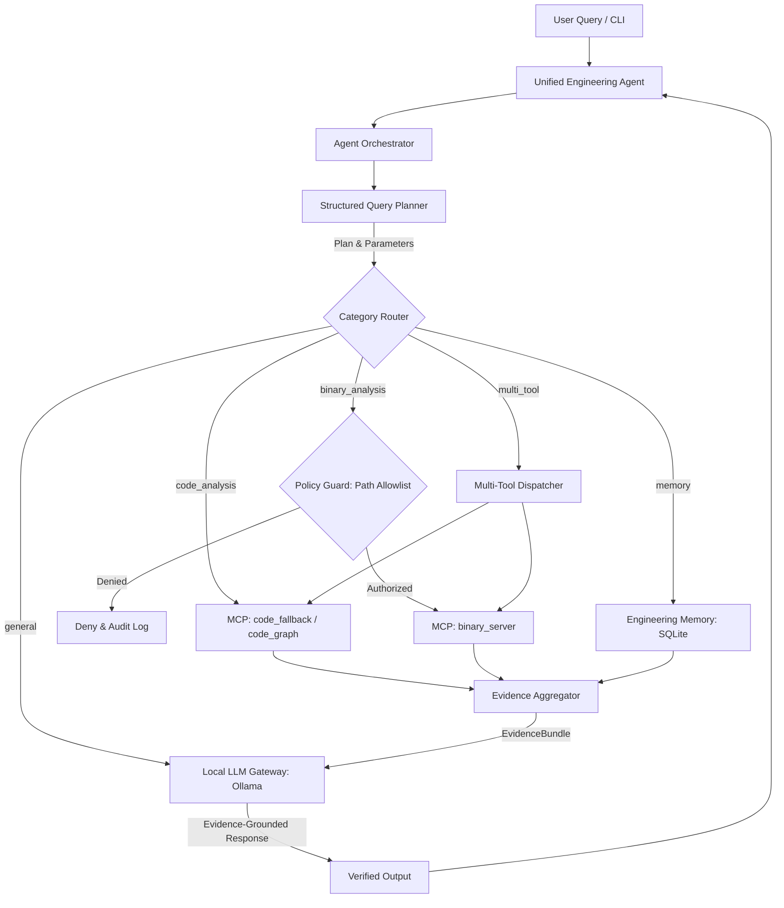

# Samsung PRISM — Unified Local-LLM Engineering Agent

### Local AI Agent for Code Comprehension, Static Binary Investigation, and Persistent Engineering Memory

---

## 1. Project Overview

The **Unified Engineering Agent** is an on-premise, zero-cloud developer assistant developed for the **Samsung PRISM** program. It integrates a locally hosted Large Language Model (via Ollama) with Model Context Protocol (MCP) tool servers and persistent SQLite memory to perform:

1. **Code Comprehension:** Query functions, callers, callees, classes, module dependencies, and change-impact graphs across local repositories.
2. **Static Binary Investigation:** Inspect authorised Windows PE/DLL binaries, view architecture, sections, export/import symbols, printable strings, and Capstone machine code disassembly without executing the binary.
3. **Persistent Engineering Memory:** Multi-session knowledge store with verification tagging (`VERIFIED`, `HYPOTHESIS`, `NEEDS_REVIEW`), secret redaction, and duplicate detection.
4. **Evidence-Grounded Answers:** Local LLM answers are strictly constrained to empirical tool outputs, citing files, line numbers, and symbol addresses.

---

## 2. System Architecture



---

## 3. Technology Stack

| Technology | Purpose |
|---|---|
| **Python 3.11+** | Core programming language |
| **Ollama** | Local zero-egress LLM execution daemon |
| **Qwen 2.5 1.5B** *(Default)* | Baseline lightweight local language model |
| **Model Context Protocol (MCP)** | Standardized tool communication protocol (MCP Python SDK 2.3.0) |
| **Python AST** | Syntactic code analysis and graph traversal fallback |
| **pefile** | Windows PE binary inspection (headers, sections, imports/exports) |
| **Capstone Engine** | Multi-architecture machine code disassembler (x86/x64) |
| **SQLite3** | Persistent engineering knowledge and session store |
| **Pydantic v2** | Strict query plan and data validation |

---

## 4. Project Structure

```text
Autonomous-Agentic-for-github-delivery-and-strategic-assessment/
├── config/
│   ├── settings.py           # Centralized configuration loaded from .env
│   └── mcp_servers.json      # Declarative MCP server registry
├── agent/
│   ├── main.py               # Interactive CLI entry point
│   ├── orchestrator.py       # Async pipeline coordinating planner, tools & LLM
│   ├── llm.py                # LocalLLM Ollama gateway (configurable)
│   ├── planner.py            # Structured Pydantic query planner
│   ├── mcp_client.py         # Persistent multi-server MCP client manager
│   ├── evidence.py           # Evidence normalization and prompt grounding
│   └── policy.py             # Path authorization, secret redaction & audit log
├── code_analysis/
│   └── code_server.py        # Code analysis MCP server (AST tools)
├── binary_analysis/
│   └── binary_server.py      # Binary analysis MCP server (PE/Capstone tools)
├── memory/
│   ├── memory.py             # Persistent SQLite engineering memory CRUD
│   ├── session_manager.py    # Multi-session lifecycle manager
│   ├── binary_audit.log      # Append-only audit log of binary inspection requests
│   └── engineering_memory.db # SQLite database file
├── mcp_server/
│   └── test_server.py        # Diagnostic smoke-test MCP server
├── benchmarks/
│   ├── datasets/             # Ground truth benchmark tasks
│   │   └── milestone1_ground_truth.json
│   ├── results/              # Benchmark evaluation reports
│   └── benchmark_runner.py   # Automated benchmark evaluation suite
├── tests/
│   ├── test_planner.py
│   ├── test_memory.py
│   ├── test_policy.py
│   ├── test_code_analysis.py
│   ├── test_binary_analysis.py
│   ├── test_mcp_client.py
│   └── test_orchestrator.py
├── docs/
│   ├── architecture.md       # Comprehensive system architecture document (15 components)
│   ├── model_comparison.md   # Comparative evaluation across 8 dimensions (Qwen, Phi-3.5, Mistral)
│   ├── security.md           # Security architecture, authorization policies, and threat model
│   └── milestone_1_completion_report.md # Formal Milestone 1 verification & readiness report
├── .env.example              # Environment configuration template
├── requirements.txt          # Python dependencies
└── README.md
```

---

## 5. Quick Start & Installation

### 5.1 Clone the Repository
```bash
git clone https://github.com/VidhiSidana/Autonomous-Agentic-for-github-delivery-and-strategic-assessment.git
cd Autonomous-Agentic-for-github-delivery-and-strategic-assessment
```

### 5.2 Create and Activate a Virtual Environment
```bash
python3 -m venv .venv
source .venv/bin/activate   # On Windows: .venv\Scripts\Activate.ps1
```

### 5.3 Install Dependencies
```bash
pip install -r requirements.txt
```

### 5.4 Configure Environment Variables
Copy the template and configure your local settings:
```bash
cp .env.example .env
```

To enable binary analysis on sample files, add their directory to `.env`:
```ini
BINARY_ALLOWED_DIRS=/path/to/my/binaries,/tmp/samples
```

### 5.5 (Optional) Install & Pull Local LLM Model
Download Ollama from [ollama.com](https://ollama.com/) and pull the default model:
```bash
ollama pull qwen2.5:1.5b
```
*(If Ollama is offline or the model is not pulled, the agent cleanly provides empirical tool evidence directly).*

---

## 6. Running the Agent

Start the interactive CLI:
```bash
python agent/main.py
```

### Example Commands:

#### Code Comprehension:
```text
You: Find functions in this codebase
You: Who calls process_query?
You: Which modules does agent/main.py depend on?
You: What is the change impact of modifying calculate_checksum?
```

#### Binary Analysis:
```text
You: Analyse binary /path/to/my/sample.exe and identify its architecture
You: Disassemble binary /path/to/my/sample.exe
You: Extract printable strings from binary /path/to/my/sample.exe
```

#### Persistent Engineering Memory & Confirmation Flow:
```text
You: Remember this finding: SQLite uses WAL mode for concurrent access. This is verified.
You: Search memory for SQLite findings
You: Retrieve previous engineering findings
You: /pending                               # List pending findings awaiting confirmation
You: /confirm 1                             # Promote proposed finding to CONFIRMED status
You: /reject 2 False positive candidate     # Reject finding with engineer rationale
You: summary                                # Display session info and recent stored items
```

#### Multi-Tool Query:
```text
You: Find the authentication function in the codebase and compare with related binary functionality in app.exe
```

---

## 7. Automated Testing & Verification

Run the entire automated test suite:
```bash
# Ensure dependencies are installed in your activated virtual environment:
# pip install -r requirements.txt

python3 -m unittest discover -s tests -p "test_*.py" -v
```

> [!IMPORTANT]
> **Environment Dependency & Test Discovery:**
> - **In an activated environment with dependencies installed (`pip install -r requirements.txt`):** All 12 test modules load cleanly and **82/82 tests pass (100%)** in ~4.5 seconds.
> - **In an unprovisioned environment (without `mcp`, `pefile`, and `capstone` installed):** Test discovery logs `ModuleNotFoundError` for external dependencies, discovering only tests that rely exclusively on the Python standard library.
> Always run tests with the active virtual environment containing `requirements.txt`.

**Discovered Test Breakdown (82 Total):**
- `tests/test_confirmation_flow.py`: **5 tests** (Lifecycle `PROPOSED` -> `CONFIRMED`/`REJECTED`, provenance, priority ordering, evidence context formatting)
- `tests/test_unified_memory_layer.py`: **8 tests** (Session hooks, extractive/LLM summarization, Markdown export/import, deduplication, stale detection, resume digest)
- `tests/test_context_budget.py`: **5 tests** (Category tool routing, REA compact subset filtering, priority compaction, prompt guardrails)
- `tests/test_planner.py`: **14 tests** (Routing, category detection, multi-tool detection, missing binary paths, case-preservation)
- `tests/test_policy.py`: **15 tests** (Canonical path allowlist, traversal `..` defense, symlink escapes, sibling directory rejection, case differences, secret redaction, append-only audit logging, REA path authorization)
- `tests/test_binary_analysis.py`: **6 tests** (PE headers, Capstone disassembly, section boundaries, invalid files, audit failures, REA prerequisites)
- `tests/test_mcp_client.py`: **6 tests** (Lifecycle management, schema discovery, parameter passing, subprocess cleanup)
- `tests/test_code_analysis.py`: **7 tests** (AST function extraction, caller tracing, module dependency graph, class outlines)
- `tests/test_memory.py`: **6 tests** (CRUD operations, session filtering, status updates, multi-threading)
- `tests/test_unified_memory.py`: **7 tests** (Backward-compatible memory retrieval & hypothesis lifecycle)
- `tests/test_orchestrator.py`: **2 tests** (Routing, dynamic schema validation, memory cycle)
- `tests/test_benchmark_runner.py`: **1 test** (17 ground-truth suite validation, cross-process persistence verification)

---

## 8. Benchmark & Model Evaluation

### 8.1 Deterministic Ground-Truth Benchmark Suite
Run the 17-task ground-truth benchmark suite:
```bash
python3 benchmarks/benchmark_runner.py
```
- **Results:** 17/17 tasks passing (100.0% success rate across PE architecture, section headers, imports/exports, Capstone disassembly, code architecture, cross-process persistence, multi-tool dual-branch execution, dynamic schema validation, and REA integration with fallback comparison).
- **Execution Latency:** Total deterministic suite execution time is ~1.56 seconds (average **0.0917s** per task; ~1.85s including independent subprocesses).
- **Output Report:** Saved to `benchmarks/results/benchmark_report.json` with repository-relative paths. Raw execution log is preserved in `benchmarks/verification/benchmark_run.txt`.

### 8.2 Milestone 2 Context Budget & Dynamic Tool Router Benchmark
Run the context budget benchmark measuring token reduction and tool selection:
```bash
python3 benchmarks/benchmark_context_budget.py
```
- **Prompt Token Reductions:**
  - `qwen2.5:1.5b`: **64.2% token reduction** (13,472 -> 4,821 prompt tokens, 8,651 tokens saved; latency reduced from 0.428s to 0.341s).
  - `phi3.5:latest`: **65.1% token reduction** (16,399 -> 5,724 prompt tokens, 10,675 tokens saved; latency reduced from 1.107s to 0.930s).
  - `llama3.1:8b`: **63.9% token reduction** (13,423 -> 4,840 prompt tokens, 8,583 tokens saved; 81.2% accuracy preserved).
  - `mistral-nemo:12b`: **NOT TESTED** (Not installed in local Ollama daemon).
- **Output Report:** Saved to `benchmarks/results/context_budget_report.json`.

### 8.3 Milestone 2 End-to-End Evaluation Suite (Zero-Egress Verified)
Run the full 22-task end-to-end evaluation comparing Baseline (grep/file-read) against the Full Agent:
```bash
python3 benchmarks/e2e_eval.py
```
- **Zero-Egress Isolation:** **PASSED** (0 non-local socket connections detected; verified 100% on-premise execution).
- **Overall Success Rate:** **100.0%** (22/22) for Full Agent vs **27.3%** (6/22) for Baseline (+72.7% advantage).
- **Multi-Session Resume Success:** **100.0%** (resumed sessions accurately restore prior session findings).
- **False-Hypothesis Rate:** **0.0%** (unverified findings quarantined as `PROPOSED`).
- **Output Reports:** Saved to `benchmarks/results/e2e_report.json`, `benchmarks/verification/e2e_run.txt`, and [`docs/evaluation_report.md`](docs/evaluation_report.md).

---

## 9. Milestone 1 & 2 Implementation Status

| Feature | Milestone | Status | Notes |
|---|---|---|---|
| **Local LLM Gateway** | M1 | **IMPLEMENTED AND TESTED** | Configurable Ollama client with timeout, availability checks & graceful fallback |
| **Structured Query Planner** | M1 | **IMPLEMENTED AND TESTED** | Pydantic `QueryPlan` with parameter extraction and clarification triggers |
| **Multi-Server MCP Client** | M1 | **IMPLEMENTED AND TESTED** | Dynamic tool discovery, inputSchema caching, argument validation against schemas, clean timeout disconnects |
| **Dynamic MCP Orchestrator**| M1 | **IMPLEMENTED AND TESTED** | Dynamic intent-to-tool mapping, schema argument validation, explicit unsupported operation reporting, AST fallback |
| **Code Analysis MCP (AST)** | M1 | **IMPLEMENTED AND TESTED** | Function/class discovery, caller/callee finding, imports, 2-hop change impact |
| **codebase-memory-mcp** | M1 | **IMPLEMENTED AND TESTED** | Connected to live `codebase-memory-mcp v0.12.1` over stdio. Discovered 17 tools dynamically, indexed 636 nodes / 2,139 edges across 26 Python modules |
| **Binary Analysis MCP** | M1 | **IMPLEMENTED AND TESTED** | Static PE inspection, architecture, exports, imports, strings, Capstone disassembly |
| **REA Integration Adapter** | M1 | **IMPLEMENTED / PREREQUISITE_BLOCKED** | Open-source Reverse Engineer Anything (REA) adapter (`morluto/rea`, npm: `rea-agents`). Enforces fail-closed policy authorization, detects Node.js >= 22.23.4 / Ghidra prerequisites, and gracefully falls back to `pefile`/`Capstone` |
| **Policy & Path Security** | M1 | **IMPLEMENTED AND TESTED** | Filesystem-aware inode containment checks (`os.path.samefile`), strict directory allowlist (`BINARY_ALLOWED_DIRS`), traversal rejection, symlink escape defense, sibling directory defense, append-only CSV audit logging |
| **Unified Engineering Memory** | M1 | **IMPLEMENTED AND TESTED** | SQLite CRUD, verification tagging, secret redaction, duplicate detection |
| **Engineer Confirmation Flow** | M2 | **IMPLEMENTED AND TESTED** | Explicit lifecycle `PROPOSED` -> `CONFIRMED`/`REJECTED`, CLI commands (`/pending`, `/confirm`, `/reject`), provenance tracking, fact retrieval exclusion |
| **Session Capture Hooks** | M2 | **IMPLEMENTED AND TESTED** | Automatic hooks (`on_query`, `on_tool_result`, `on_session_end`), `session_events` audit table, local Ollama summarization with extractive fallback |
| **Curated Markdown Memory** | M2 | **IMPLEMENTED AND TESTED** | Two-way lossless sync between SQLite and `memory/curated/*.md`, YAML frontmatter, dual-layer deduplication (hash + Jaccard), stale detection, secret redaction |
| **Dynamic Tool Router** | M2 | **IMPLEMENTED AND TESTED** | Category-relevant 4-8 tools filter, compact REA tool subset, 64.2% prompt token reduction on Qwen 1.5B |
| **Context Budget Manager** | M2 | **IMPLEMENTED AND TESTED** | Model-specific token budgets, priority compaction order, dropped component audit logging, synthesis guardrails |
| **End-to-End Evaluation** | M2 | **IMPLEMENTED AND TESTED** | 22 tasks (17 ground truth, 3 real code, 2 multi-session resume), 100% Full Agent vs 27.3% Baseline |
| **Zero-Egress Network Isolation** | M2 | **IMPLEMENTED AND TESTED** | Active socket-level zero-egress monitor (`ZeroEgressMonitor`), 0 external packets, 100% on-premise execution |

---

## 10. Authors & Acknowledgements

Developed for **Samsung PRISM**:
* **Vidhi Sidana** — GitHub: [@VidhiSidana](https://github.com/VidhiSidana)
* **Chintan Sood** — GitHub: [@chintansood](https://github.com/chintansood)
