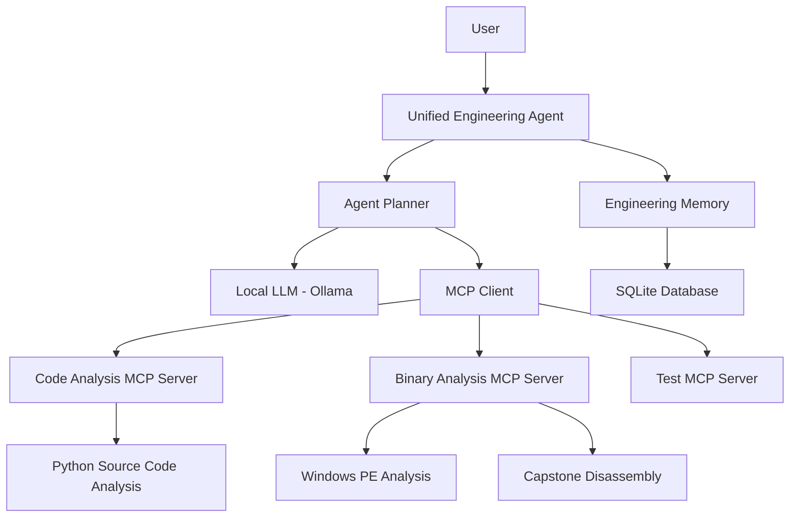

# Unified Engineering Agent

### Local LLM Agent for Code Comprehension, Binary Investigation, and Persistent Engineering Memory

## Overview

The **Unified Engineering Agent** is a locally running AI-powered engineering assistant designed to help developers understand source code, investigate Windows executable files, and store engineering findings for future retrieval.

The project combines a local Large Language Model (LLM), Model Context Protocol (MCP) servers, Python code analysis, binary investigation, and persistent SQLite memory.

## Features

### 1. Code Comprehension
- Discover Python functions in a project.
- Identify function calls and callers.
- Analyze module imports and dependencies.
- Display file paths and line numbers.
- Exclude unnecessary directories such as `.venv`.

### 2. Binary Investigation
- Analyze Windows PE executable files and DLLs.
- Identify executable architecture and sections.
- Discover exported functions.
- Disassemble machine instructions using Capstone.
- Display assembly instructions and addresses.

### 3. Persistent Engineering Memory
- Save engineering findings.
- Search stored findings.
- Retrieve previous findings.
- Preserve information across agent restarts using SQLite.

### 4. Local AI Integration
- Use Ollama to run a local LLM.
- Integrate Qwen2.5 1.5B.
- Route user queries using an agent planner.
- Connect analysis tools through MCP.

## System Architecture



## Technologies Used

| Technology | Purpose |
|---|---|
| Python | Main development language |
| Ollama | Local LLM execution |
| Qwen2.5 1.5B | Local language model |
| MCP | Tool integration |
| AST | Python source-code analysis |
| pefile | Windows PE binary inspection |
| Capstone | Machine-code disassembly |
| SQLite | Persistent engineering memory |
| Git and GitHub | Version control |

## Project Structure

```text
Unified-Engineering-Agent/
│
├── agent/
│   ├── main.py
│   ├── llm.py
│   ├── planner.py
│   └── mcp_client.py
│
├── code_analysis/
│   └── code_server.py
│
├── binary_analysis/
│   └── binary_server.py
│
├── mcp_server/
│   └── test_server.py
│
├── memory/
│   └── memory.py
│
├── docs/
│   └── architecture.md
│
├── requirements.txt
└── README.md
```

## Installation

### Prerequisites

- Python 3.11
- Git
- Ollama
- Windows operating system for the current PE binary-analysis implementation

### 1. Clone the repository

```bash
git clone https://github.com/VidhiSidana/Autonomous-Agentic-for-github-delivery-and-strategic-assessment.git
```

### 2. Navigate to the project

```bash
cd Unified-Engineering-Agent
```

### 3. Create a virtual environment

```bash
python -m venv .venv
```

Activate it on Windows:

```powershell
.\.venv\Scripts\Activate.ps1
```

### 4. Install dependencies

```bash
pip install -r requirements.txt
```

### 5. Install and start Ollama

Download Ollama from:

https://ollama.com/

Pull the Qwen model:

```bash
ollama pull qwen2.5:1.5b
```

Ensure Ollama is running before starting the agent.

## Running the Agent

From the project root:

```bash
python agent/main.py
```

The agent will start and accept user queries.

Type `exit` to stop the agent.

## Example Queries

### Code Analysis

```text
Find functions in my project
```

```text
Who calls process_query?
```

```text
Which modules does agent/main.py depend on?
```

### Binary Analysis

```text
Analyze binary information
```

```text
Find exported binary functions
```

```text
Disassemble binary instructions
```

When prompted, provide the path to a Windows executable or DLL.

### Engineering Memory

```text
Remember this finding
```

```text
Search engineering memory
```

```text
Retrieve my engineering memory
```

## Benchmark Evaluation

The project uses the following benchmark task categories:

| Task ID | Description |
|---|---|
| C1 | Function discovery |
| C2 | Caller analysis |
| C3 | Module relationship analysis |
| B1 | Binary function discovery |
| B2 | Binary disassembly |
| M1 | Save engineering finding |
| M2 | Retrieve memory in a new session |

Benchmark results are intended to record task accuracy, execution time, token usage, tool calls, and supporting evidence.

## Current Implementation Status

Implemented and tested:

- Local LLM integration
- MCP client and server integration
- Python function discovery
- Caller analysis
- Module relationship analysis
- Windows PE metadata inspection
- Exported function discovery
- Entry-point disassembly
- Persistent SQLite memory
- Memory retrieval across agent restarts

## Limitations

- Binary analysis currently focuses on Windows PE files.
- Exported function discovery does not identify every internal function.
- Disassembly currently starts at the executable entry point.
- Code analysis currently focuses on Python source files.
- Formal benchmark evaluation and evidence verification are still being developed.

## Future Improvements

- Improved binary function identification.
- Function-level binary disassembly.
- Stronger evidence-backed response verification.
- Automated benchmark evaluation.
- Improved engineering memory retrieval.
- Support for additional binary formats.

## Author

**Vidhi Sidana**
**Chintan Sood**

GitHub: [VidhiSidana](https://github.com/VidhiSidana)
GitHub: [VidhiSidana](https://github.com/chintansood)
