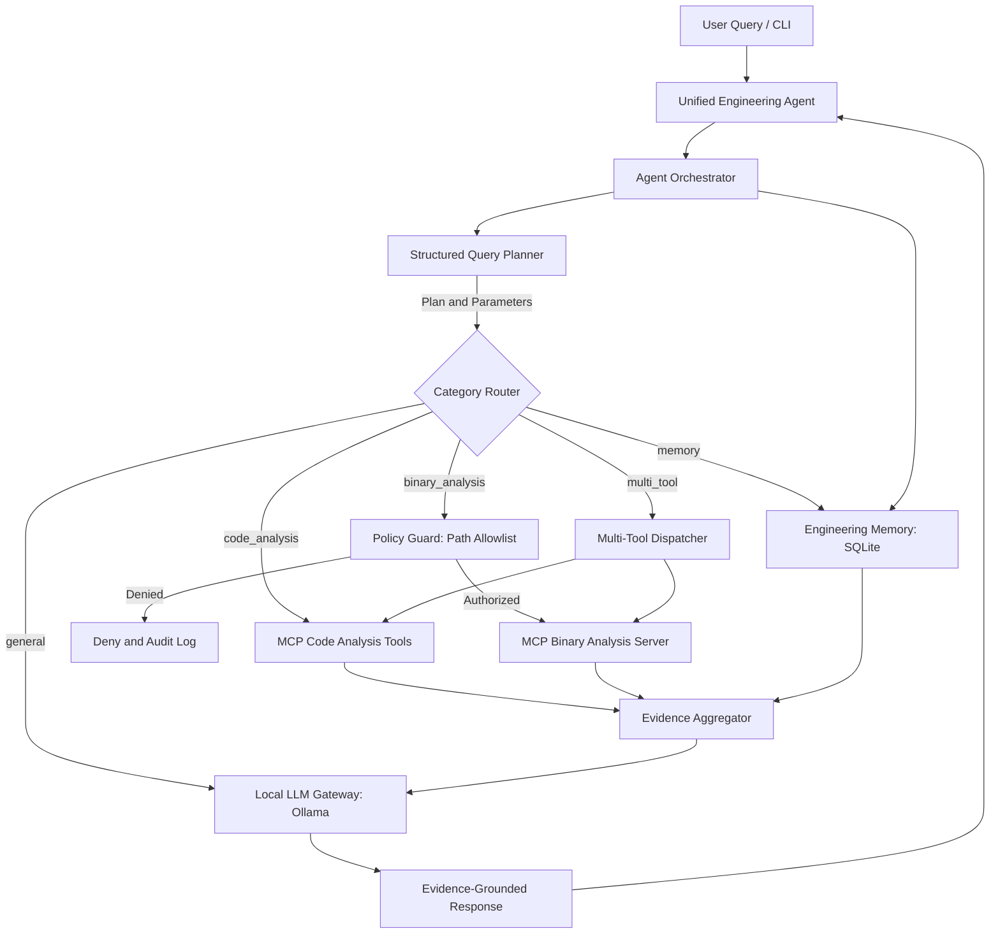

# Samsung PRISM — Unified Local-LLM Engineering Agent

### Local AI Agent for Code Comprehension, Static Binary Investigation, and Persistent Engineering Memory

---

## 1. Project Overview

The **Unified Engineering Agent** is an on-premise, local-LLM developer assistant developed for the **Samsung PRISM** program. It integrates a locally hosted Large Language Model (LLM) through Ollama with Model Context Protocol (MCP) tool servers, evidence aggregation, and persistent SQLite memory.

The agent is designed to support:

1. **Code Comprehension:** Query functions, callers, callees, classes, module dependencies, and change-impact graphs across local repositories.
2. **Static Binary Investigation:** Inspect authorized Windows PE/DLL binaries, including architecture, sections, imports/exports, printable strings, and Capstone machine-code disassembly without executing the binary.
3. **Persistent Engineering Memory:** Store and retrieve engineering findings across sessions, with verification tagging, secret redaction, and duplicate detection.
4. **Evidence-Grounded Answers:** Use empirical tool outputs to support responses with relevant source files, line numbers, and binary evidence when available.
5. **Multi-Tool Orchestration:** Coordinate code analysis, binary investigation, memory retrieval, and local LLM response generation.

---

## 2. System Architecture



### Architecture Components

| Component | Responsibility |
|---|---|
| Engineering Agent | Interactive CLI and user-query entry point |
| Planner | Determines query category and extracts relevant parameters |
| Orchestrator | Coordinates planning, tool execution, memory, and response generation |
| Local LLM Gateway | Connects to Ollama for local inference |
| MCP Client | Connects to configured MCP servers and discovers tools |
| Code Analysis Server | Provides source-code analysis capabilities |
| Binary Analysis Server | Provides static binary investigation capabilities |
| Evidence Aggregator | Normalizes and organizes tool results |
| Persistent Memory | Stores and retrieves engineering findings |
| Security Policy | Enforces configured authorization and validation rules |
| Audit Logging | Records relevant security and binary-analysis events |

---

## 3. Technology Stack

| Technology | Purpose |
|---|---|
| Python 3.11+ | Core programming language |
| Ollama | Local LLM runtime |
| Qwen 2.5 1.5B | Default lightweight local language model |
| Model Context Protocol (MCP) | Standardized tool communication |
| Python AST | Source-code parsing and analysis |
| pefile | Windows PE binary inspection |
| Capstone Engine | Machine-code disassembly |
| SQLite3 | Persistent engineering memory |
| Pydantic | Query-plan and data validation |
| asyncio | Asynchronous execution |
| unittest | Automated testing |
| Git and GitHub | Version control |

---

## 4. Project Structure

```text
Autonomous-Agentic-for-github-delivery-and-strategic-assessment/
├── config/
│   ├── settings.py
│   └── mcp_servers.json
├── agent/
│   ├── main.py
│   ├── orchestrator.py
│   ├── llm.py
│   ├── planner.py
│   ├── mcp_client.py
│   ├── evidence.py
│   └── policy.py
├── code_analysis/
│   └── code_server.py
├── binary_analysis/
│   ├── binary_server.py
│   └── rea_adapter.py
├── memory/
│   ├── memory.py
│   ├── session_manager.py
│   ├── curated/
│   └── engineering_memory.db
├── mcp_server/
│   └── test_server.py
├── benchmarks/
│   ├── datasets/
│   │   └── milestone1_ground_truth.json
│   ├── results/
│   ├── verification/
│   ├── benchmark_runner.py
│   ├── benchmark_context_budget.py
│   └── e2e_eval.py
├── tests/
│   ├── test_benchmark_runner.py
│   ├── test_binary_analysis.py
│   ├── test_code_analysis.py
│   ├── test_mcp_client.py
│   ├── test_memory.py
│   ├── test_orchestrator.py
│   ├── test_planner.py
│   ├── test_policy.py
│   ├── test_confirmation_flow.py
│   ├── test_unified_memory.py
│   ├── test_unified_memory_layer.py
│   └── test_context_budget.py
├── docs/
│   ├── architecture.md
│   ├── evaluation_report.md
│   ├── model_comparison.md
│   └── security.md
├── .env.example
├── .gitignore
├── requirements.txt
└── README.md
```

*Note: This is a representative project structure. Runtime-generated databases, logs, reports, and additional modules may be present depending on the current configuration.*

---

## 5. Quick Start & Installation

### 5.1 Prerequisites

- Python 3.11 or a compatible version supported by the project.
- Git.
- Ollama.
- Windows PowerShell for the documented Windows commands.
- Visual Studio Code (recommended).

### 5.2 Clone the Repository

```powershell
git clone https://github.com/VidhiSidana/Autonomous-Agentic-for-github-delivery-and-strategic-assessment.git

cd Autonomous-Agentic-for-github-delivery-and-strategic-assessment
```

### 5.3 Create and Activate a Virtual Environment

Create the environment:

```powershell
python -m venv .venv
```

Activate it in Windows PowerShell:

```powershell
.venv\Scripts\Activate.ps1
```

For Linux/macOS:

```bash
source .venv/bin/activate
```

### 5.4 Install Dependencies

```powershell
python -m pip install -r requirements.txt
```

### 5.5 Configure Environment Variables

Copy the template file:

```powershell
Copy-Item .env.example .env
```

Review the configuration in:

- `config/settings.py`
- `config/mcp_servers.json`
- `.env.example`

Configure local paths and settings according to the project setup.

For binary analysis, configure authorized binary directories using the environment variable supported by the project:

```ini
BINARY_ALLOWED_DIRS=/path/to/authorized/binaries
```

Use actual local directories in your environment. Do not commit secrets, credentials, or sensitive environment values to version control.

### 5.6 Install and Configure Ollama

Download Ollama from:

https://ollama.com/

Pull the default model:

```powershell
ollama pull qwen2.5:1.5b
```

Verify that it is available:

```powershell
ollama list
```

Test the model:

```powershell
ollama run qwen2.5:1.5b "Explain what a Python function is in two sentences."
```

The project uses Ollama for local inference. Ensure Ollama is running before launching the agent.

If the LLM is unavailable, the application may use its configured fallback behavior to return empirical tool evidence where supported.

---

## 6. Running the Agent

From the project root, activate the virtual environment and run:

```powershell
python agent/main.py
```

The agent starts its interactive CLI and accepts engineering queries.

### 6.1 Code Comprehension Examples

```text
Who calls process_query?
```

```text
Find functions in this codebase.
```

```text
Which modules does agent/main.py depend on?
```

```text
Find the definition of a function in the source code.
```

The available operations depend on the configured code-analysis tools and the repository being analyzed.

### 6.2 Binary Investigation Examples

Use only binaries you are authorized to inspect and paths permitted by the configured security policy.

```text
Analyze binary /path/to/authorized/sample.exe and identify its architecture.
```

```text
Disassemble binary /path/to/authorized/sample.exe.
```

```text
Extract printable strings from binary /path/to/authorized/sample.exe.
```

Binary-analysis capabilities depend on the supported file format, installed dependencies, and configured MCP tools.

### 6.3 Persistent Engineering Memory Examples

```text
Remember this finding: SQLite uses WAL mode for concurrent access. This is verified.
```

```text
Search memory for SQLite findings.
```

```text
Retrieve previous engineering findings.
```

Memory operations depend on the implemented planner and memory-tool interfaces.

### 6.4 Multi-Tool Query Example

```text
Find the authentication function in the codebase and compare it with related binary functionality in an authorized application binary.
```

The orchestrator can route supported multi-tool queries to the relevant analysis tools and aggregate their results.

---

## 7. Automated Testing & Verification

Run the complete automated test suite from the activated virtual environment:

```powershell
# Install dependencies if not already installed
pip install -r requirements.txt

# Run all tests
python -m unittest discover -s tests -p "test_*.py" -v
```

### 7.1 Final Hardening-Branch Validation (2026-11-11)

Final acceptance validation was completed on the `milestone2-hardening`
branch in the Windows Python 3.11 virtual environment.

| Validation | Command / scope | Result |
|---|---|---:|
| Ground-truth benchmark | `python benchmarks/benchmark_runner.py` | **17/17 passed (100.0%)** |
| Full unit-test discovery | `python -m unittest discover -s tests -p "test_*.py" -t .` | **114 tests; OK; 3 skipped** |
| Policy matcher regression | Two focused matcher tests | **2/2 passed** |
| Cross-process persistence | Included in the ground-truth benchmark | **Passed** |

The ground-truth benchmark passed all code-analysis (C1-C4), binary-analysis
(B1-B6), memory (M1-M3), multi-tool (MT1), and REA integration (REA1-REA3)
tasks. Its final report recorded 17 total tasks, 17 passed, and a 100.0%
success rate.

Full test discovery reported `Ran 114 tests in 600.384s` and
`OK (skipped=3)`, with no failures or errors. Three skipped tests are
reported separately and are not counted as passes.

The focused policy-matcher regression tests passed 2/2. Cross-process
persistence was also verified by the benchmark, including record identity,
content, verification status, and session association.

**Milestone 2 acceptance validation was completed on `milestone2-hardening` and the hardening work was subsequently merged into `main`.** The merge commit is `4f68c46b20fca07da09df9ef12664eaef23f5155`.

### 7.2 Historical Complete Test Snapshot

An earlier complete standard test run reported:

| Metric | Historical result |
|---|---:|
| Total tests | 86 |
| Passed | 82 |
| Skipped | 4 |
| Failures | 0 |
| Errors | 0 |
| Execution time | 170.406 seconds |

The four skipped tests were not counted as passed tests. This historical
snapshot must not be presented as a fresh run of the current branch.

### 7.3 Test Coverage

The test suite covers:

- Query planning and category routing.
- Code analysis and AST-based relationships.
- Static binary and PE analysis.
- MCP client lifecycle and argument validation.
- Persistent engineering memory and session management.
- Policy enforcement and path authorization.
- Secret redaction and audit logging.
- Context budgeting and dynamic tool routing.
- Orchestration and benchmark execution.
- Cross-process memory persistence.
- Session capture and confirmation workflows.

### 7.4 Run Individual Test Modules

MCP client tests:

```powershell
python -m unittest tests.test_mcp_client -v
```

Memory tests:

```powershell
python -m unittest tests.test_memory -v
```

Orchestrator tests:

```powershell
python -m unittest tests.test_orchestrator -v
```

Benchmark runner tests:

```powershell
python -m unittest tests.test_benchmark_runner -v
```

Always use the activated virtual environment with dependencies installed.

---

## 8. Benchmark & Model Evaluation

### 8.1 Deterministic Ground-Truth Benchmark Suite

Run the 17-task ground-truth benchmark:

```powershell
python benchmarks/benchmark_runner.py
```

**Final hardening-branch benchmark result (2026-11-11):**

- **Tasks passed:** 17/17.
- **Success rate:** 100.0%.
- **Cross-process persistence:** Verified successfully, including record identity, content, status, and session association.
- **Coverage:** Code analysis, PE architecture, binary sections, imports and exports, disassembly, engineering memory, multi-tool execution, REA integration, and fallback behavior.

These results were produced by the final benchmark run on `milestone2-hardening` in the Windows Python 3.11 environment on 2026-11-11.

The benchmark validates deterministic tool and system behavior against known expected results. It does not represent the accuracy of every natural-language response generated by an LLM.

**Output report:**

```text
benchmarks/results/benchmark_report.json
```

### 8.2 Context Budget & Dynamic Tool Router Benchmark

Run the context-budget benchmark:

```powershell
python benchmarks/benchmark_context_budget.py
```

The benchmark compares a monolithic tool context against the dynamic tool router across 16 tasks per model.

| Model | Monolithic prompt tokens | Dynamic router tokens | Token reduction | Router accuracy |
|---|---:|---:|---:|---:|
| Qwen 2.5 1.5B | 13,472 | 7,299 | 45.8% | 87.5% |
| Phi 3.5 | 16,399 | 8,945 | 45.5% | 87.5% |
| Llama 3.1 8B | 13,423 | 7,330 | 45.4% | 93.8% |
| Mistral Nemo 12B | Not tested | Not tested | Not available | Not available |

The dynamic router reduced prompt-token consumption while maintaining or improving tool-call accuracy in the evaluated tasks.

**Output report:**

```text
benchmarks/results/context_budget_report.json
```

### 8.3 Milestone 2 End-to-End Evaluation

Run the 22-task end-to-end evaluation comparing the baseline (grep/file-read approach) with the Full Agent:

```powershell
python benchmarks/e2e_eval.py
```

**Historical summary previously recorded in this README (superseded by the artifact reconciliation below):**

| Evaluation metric | Qwen 2.5 1.5B | Llama 3.1 8B |
|---|---:|---:|
| Baseline success | 7/22 (31.8%) | 10/22 (45.5%) |
| Full Agent success | 21/22 (95.5%) | 21/22 (95.5%) |
| Ground-truth tasks passed by Full Agent | 17/17 | 17/17 |
| Real repository tasks passed | 3/3 | 3/3 |
| Multi-session resume success | 1/2 (50%) | 1/2 (50%) |
| False-hypothesis rate | 1/3 (33.3%) | 1/3 (33.3%) |

**Interpretation and limitations:**

- The table above is an older summary and should not be treated as the latest result.
- The timestamped 2026-11-10 Qwen artifact records 22/22 tasks and 2/2 multi-session resume scenarios. These are historical artifact results, not a fresh run of the current hardening branch.
- In the false-hypothesis evaluation, one of three tested claims was incorrectly asserted. Evidence-grounding therefore still requires improvement.
- A simple grep or file-read baseline can be faster for trivial single-file searches because the Full Agent adds planning, tool execution, evidence processing, and response synthesis overhead.

**Zero-egress monitoring:**

The evaluation's socket monitor reported `PASSED`, with no non-local socket connections detected.

Its monitoring scope covers `socket.socket.connect` within the Python process; child-process standard I/O uses inherited pipes. This is evidence from the configured monitor, not an independent packet-capture guarantee.

**Output reports:**

```text
benchmarks/results/e2e_report.json
benchmarks/verification/e2e_run.txt
docs/evaluation_report.md
```

**Evaluation artifact reconciliation (2026-11-11):** The committed JSON report and execution log are timestamped 2026-11-10 and record Qwen 2.5 1.5B at 22/22 tasks and 2/2 resume scenarios. A previous README summary records 21/22 and 1/2. The timestamped artifacts are the traceable historical evidence; neither result is a fresh verification of the current hardening branch. Treat the E2E score as **historical and provisional for current-branch status** until a new run is completed and its JSON, text log, and documentation are generated together. The false-hypothesis suite's corrected scorer also requires its own rerun; historical 1/3 results must not be compared with corrected-scorer results.

### 8.4 Genuine LLM Tool-Calling & Evidence Synthesis Evaluation

A separate model evaluation tested 16 tool-calling tasks and 3 evidence-synthesis cases per model.

| Metric | Qwen 2.5 1.5B | Llama 3.1 8B |
|---|---:|---:|
| Valid JSON responses | 16/16 (100%) | 16/16 (100%) |
| Tool selection accuracy | 13/16 (81.2%) | 13/16 (81.2%) |
| Required arguments present | 15/16 (93.8%) | 15/16 (93.8%) |
| Exact argument accuracy | 13/16 (81.2%) | 13/16 (81.2%) |
| Overall tool-call accuracy | 13/16 (81.2%) | 13/16 (81.2%) |
| Evidence synthesis | 2/3 (66.7%) | 2/3 (66.7%) |

The evidence-synthesis benchmark includes complete evidence, missing evidence, and contradictory-premise scenarios. Its score reflects the benchmark's recorded pass criteria and should not be interpreted as a universal hallucination rate.

**Evaluation environment:** macOS Apple Silicon with Python 3.14.2. This is separate from the Windows environment used for the automated test-suite result.

Mistral Nemo 12B was not available for this evaluation.

---

## 9. Milestone 1 & 2 Implementation Status

| Feature | Milestone | Status | Notes |
|---|---|---|---|
| Local LLM Gateway | M1 | IMPLEMENTED AND TESTED | Configurable Ollama client with timeout, availability checks, and graceful fallback |
| Structured Query Planner | M1 | IMPLEMENTED AND TESTED | Pydantic query plans, parameter extraction, and clarification triggers |
| Multi-Server MCP Client | M1 | IMPLEMENTED AND TESTED | Dynamic tool discovery, schema caching, argument validation, and subprocess lifecycle management |
| Dynamic MCP Orchestrator | M1 | IMPLEMENTED AND TESTED | Intent-to-tool mapping, schema validation, unsupported-operation reporting, and AST fallback |
| Code Analysis MCP | M1 | IMPLEMENTED AND TESTED | Function and class discovery, caller/callee analysis, imports, and change-impact analysis |
| codebase-memory-mcp | M1 | IMPLEMENTED AND TESTED | Connected over stdio; dynamically discovered tools and indexed repository structure |
| Binary Analysis MCP | M1 | IMPLEMENTED AND TESTED | Static PE inspection, architecture, exports, imports, strings, and Capstone disassembly |
| REA Integration Adapter | M1 | IMPLEMENTED / PREREQUISITE-BLOCKED | REA adapter with policy authorization, prerequisite checks, and pefile/Capstone fallback |
| Policy & Path Security | M1 | IMPLEMENTED AND TESTED | Directory allowlists, traversal protection, symlink containment, secret redaction, and audit logging |
| Unified Engineering Memory | M1 | IMPLEMENTED AND TESTED | SQLite storage, verification tagging, secret redaction, and duplicate detection |
| Engineer Confirmation Flow | M2 | IMPLEMENTED AND TESTED | PROPOSED, CONFIRMED, and REJECTED lifecycle with provenance tracking |
| Session Capture Hooks | M2 | IMPLEMENTED AND TESTED | Query, tool-result, and session-end hooks with local summarization and extractive fallback |
| Curated Markdown Memory | M2 | IMPLEMENTED AND TESTED | SQLite/Markdown synchronization, YAML frontmatter, deduplication, stale detection, and secret redaction |
| Dynamic Tool Router | M2 | IMPLEMENTED AND TESTED | Category-relevant tool filtering and compact tool contexts; 45.8% token reduction on Qwen 2.5 1.5B in the recorded evaluation |
| Context Budget Manager | M2 | IMPLEMENTED AND TESTED | Model-specific token budgets, priority-based compaction, and dropped-component audit logging |
| End-to-End Evaluation | M2 | IMPLEMENTED; HISTORICAL EVALUATION | Timestamped Qwen artifact records 22/22; not rerun after current hardening changes |
| Zero-Egress Network Monitoring | M2 | IMPLEMENTED AND TESTED | Socket-level monitoring reported no non-local connections within its stated monitoring scope |

---

## 10. Security Considerations

The agent is intended for controlled engineering investigation.

Security considerations include:

- Restricting analysis to authorized source code and binaries.
- Enforcing configured binary path allowlists.
- Validating tool arguments and user inputs.
- Avoiding exposure of confidential information.
- Protecting environment variables and secrets.
- Maintaining relevant audit logs.
- Reviewing analysis results before taking consequential actions.

The agent should only be used with resources the user is authorized to investigate.

Further security details are available in:

```text
docs/security.md
```

---

## 11. Known Limitations and Future Scope

### Current Limitations

- Local LLM response latency can increase for complex requests.
- MCP asynchronous session cleanup warnings have appeared during some test scenarios and remain under investigation.
- Analysis results depend on the available tools, input files, and configuration.
- External reverse-engineering integration may require additional dependencies or prerequisites.
- Historical E2E summaries conflicted (21/22 vs. 22/22); the timestamped artifact records 2/2 resume scenarios, but the benchmark has not been rerun after current hardening changes.
- False-hypothesis evaluation identified a case requiring improved evidence verification.
- Further benchmarking is needed across larger engineering projects.

### Future Scope

1. Improve local LLM response speed.
2. Optimize MCP session lifecycle management.
3. Expand binary-analysis capabilities.
4. Improve evidence verification and confidence scoring.
5. Add larger benchmark datasets.
6. Enhance memory retrieval and ranking.
7. Improve the user interface.
8. Expand dependency and security analysis.
9. Support more complex engineering repositories.
10. Improve robustness of multi-tool workflows.

---

## 12. Conclusion

The Samsung PRISM Unified Engineering Agent demonstrates the integration of local language models, MCP-based engineering tools, evidence aggregation, and persistent memory into a unified engineering assistance system.

The project aims to simplify code comprehension, static binary investigation, and engineering knowledge management through a modular, extensible, and locally operated AI agent.

By combining specialized analysis tools with evidence-grounded responses and persistent engineering memory, the system provides a foundation for more efficient and intelligent engineering workflows.

---

## 13. Authors & Acknowledgements

Developed for **Samsung PRISM**:

- **Vidhi Sidana** — GitHub: [@VidhiSidana](https://github.com/VidhiSidana)
- **Chintan Sood** — GitHub: [@chintansood](https://github.com/chintansood)

---

**Project Domain:** AI, Software Engineering, Code Comprehension, Static Binary Analysis
**Primary Language:** Python
**LLM Runtime:** Ollama
**Tool Integration Protocol:** Model Context Protocol (MCP)

---

## 10. Month 4 Closure & Handover

The Milestone 2 implementation has been merged into `main`. Month 4 closure focuses on a reproducible setup, live multi-session demonstration, deployment guidance, evaluation-artifact reconciliation and final handover.

| Closure resource | Purpose |
|---|---|
| [Milestone 2 Closure Report](docs/milestone_2_closure_report.md) | Final scope, recorded validation, limitations and closure exit criteria |
| [Closure Execution Plan](docs/closure_execution_plan.md) | 70/30 ownership split and acceptance checklist |
| [Live Demo Runbook](docs/demo_runbook.md) | Step-by-step code, binary and cross-session memory demonstration |
| [Internal LLM Deployment Guide](docs/internal_llm_deployment.md) | Ollama endpoint setup, security boundaries and deployment acceptance record |
| [Architecture](docs/architecture.md) | System components and data flow |
| [Security Specification](docs/security.md) | Local-first operation and binary-analysis guardrails |
| [Evaluation Report](docs/evaluation_report.md) | Benchmark methodology, historical results and evidence limitations |

**Evidence status:** The user-reported final ground-truth benchmark was 17/17 (100.0%) and full unit-test discovery was 114 tests, OK, with 3 skipped. The committed benchmark JSON and E2E logs were older artifacts at the time of closure preparation; do not treat them as the latest run. Refresh them only from the actual output of a new run. The live demonstration and deployment acceptance record must likewise be completed from actual execution.
