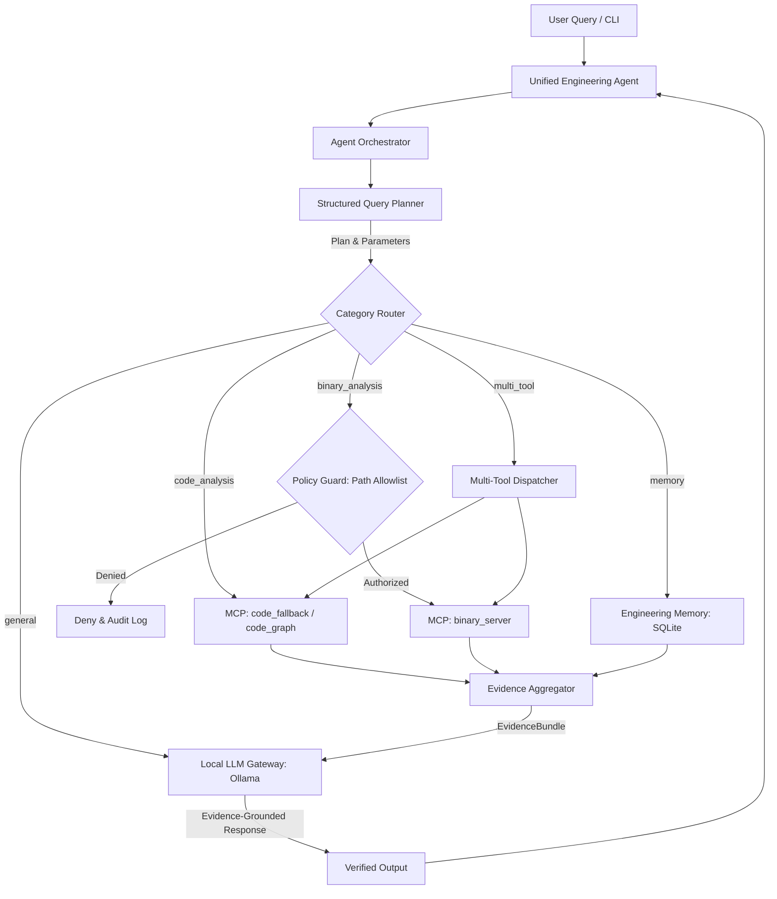

# Samsung PRISM — Unified Local-LLM Engineering Agent

### Local AI Agent for Code Comprehension, Static Binary Investigation, and Persistent Engineering Memory

---

## 1. Project Overview

The **Unified Engineering Agent** is an on-premise, zero-cloud developer assistant developed for the **Samsung PRISM** program. It integrates a locally hosted Large Language Model (via Ollama) with Model Context Protocol (MCP) tool servers and persistent SQLite memory to perform:

1. **Code Comprehension:** Query functions, callers, callees, classes, module dependencies, and change-impact graphs across local repositories.
2. **Static Binary Investigation:** Inspect authorised Windows PE/DLL binaries, view architecture, sections, export/import symbols, printable strings, and Capstone machine code disassembly without executing the binary.
3. **Persistent Engineering Memory:** Multi-session knowledge store with verification tagging (`VERIFIED`, `HYPOTHESIS`, `NEEDS_REVIEW`), secret redaction, and duplicate detection.
4. **Evidence-Grounded Answers:** Local LLM answers are strictly constrained to empirical tool outputs, citing files, line numbers, and symbol addresses.

---

## 2. System Architecture



---

## 3. Technology Stack

| Technology | Purpose |
|---|---|
| **Python 3.11+** | Core programming language |
| **Ollama** | Local zero-egress LLM execution daemon |
| **Qwen 2.5 1.5B** *(Default)* | Baseline lightweight local language model |
| **Model Context Protocol (MCP)** | Standardized tool communication protocol (MCP Python SDK 2.3.0) |
| **Python AST** | Syntactic code analysis and graph traversal fallback |
| **pefile** | Windows PE binary inspection (headers, sections, imports/exports) |
| **Capstone Engine** | Multi-architecture machine code disassembler (x86/x64) |
| **SQLite3** | Persistent engineering knowledge and session store |
| **Pydantic v2** | Strict query plan and data validation |

---

## 4. Project Structure

```text
Autonomous-Agentic-for-github-delivery-and-strategic-assessment/
├── config/
│   ├── settings.py           # Centralized configuration loaded from .env
│   └── mcp_servers.json      # Declarative MCP server registry
├── agent/
│   ├── main.py               # Interactive CLI entry point
│   ├── orchestrator.py       # Async pipeline coordinating planner, tools & LLM
│   ├── llm.py                # LocalLLM Ollama gateway (configurable)
│   ├── planner.py            # Structured Pydantic query planner
│   ├── mcp_client.py         # Persistent multi-server MCP client manager
│   ├── evidence.py           # Evidence normalization and prompt grounding
│   └── policy.py             # Path authorization, secret redaction & audit log
├── code_analysis/
│   └── code_server.py        # Code analysis MCP server (AST tools)
├── binary_analysis/
│   └── binary_server.py      # Binary analysis MCP server (PE/Capstone tools)
├── memory/
│   ├── memory.py             # Persistent SQLite engineering memory CRUD
│   ├── session_manager.py    # Multi-session lifecycle manager
│   ├── binary_audit.log      # Immutable audit log of binary inspection requests
│   └── engineering_memory.db # SQLite database file
├── mcp_server/
│   └── test_server.py        # Diagnostic smoke-test MCP server
├── benchmarks/
│   ├── datasets/             # Ground truth benchmark tasks
│   │   └── milestone1_ground_truth.json
│   ├── results/              # Benchmark evaluation reports
│   └── benchmark_runner.py   # Automated benchmark evaluation suite
├── tests/
│   ├── test_planner.py
│   ├── test_memory.py
│   ├── test_policy.py
│   ├── test_code_analysis.py
│   ├── test_binary_analysis.py
│   ├── test_mcp_client.py
│   └── test_orchestrator.py
├── docs/
│   ├── architecture.md       # Comprehensive system architecture document
│   ├── model_comparison.md  # Shortlist of evaluated open-weight models
│   └── security.md           # Security, authorization, and privacy guarantees
├── .env.example              # Environment configuration template
├── requirements.txt          # Python dependencies
└── README.md
```

---

## 5. Quick Start & Installation

### 5.1 Clone the Repository
```bash
git clone https://github.com/VidhiSidana/Autonomous-Agentic-for-github-delivery-and-strategic-assessment.git
cd Autonomous-Agentic-for-github-delivery-and-strategic-assessment
```

### 5.2 Create and Activate a Virtual Environment
```bash
python3 -m venv .venv
source .venv/bin/activate   # On Windows: .venv\Scripts\Activate.ps1
```

### 5.3 Install Dependencies
```bash
pip install -r requirements.txt
```

### 5.4 Configure Environment Variables
Copy the template and configure your local settings:
```bash
cp .env.example .env
```

To enable binary analysis on sample files, add their directory to `.env`:
```ini
BINARY_ALLOWED_DIRS=/path/to/my/binaries,/tmp/samples
```

### 5.5 (Optional) Install & Pull Local LLM Model
Download Ollama from [ollama.com](https://ollama.com/) and pull the default model:
```bash
ollama pull qwen2.5:1.5b
```
*(If Ollama is offline or the model is not pulled, the agent cleanly provides empirical tool evidence directly).*

---

## 6. Running the Agent

Start the interactive CLI:
```bash
python agent/main.py
```

### Example Commands:

#### Code Comprehension:
```text
You: Find functions in this codebase
You: Who calls process_query?
You: Which modules does agent/main.py depend on?
You: What is the change impact of modifying calculate_checksum?
```

#### Binary Analysis:
```text
You: Analyse binary /path/to/my/sample.exe and identify its architecture
You: Disassemble binary /path/to/my/sample.exe
You: Extract printable strings from binary /path/to/my/sample.exe
```

#### Persistent Engineering Memory:
```text
You: Remember this finding: SQLite uses WAL mode for concurrent access. This is verified.
You: Search memory for SQLite findings
You: Retrieve previous engineering findings
```

#### Multi-Tool Query:
```text
You: Find the authentication function in the codebase and compare with related binary functionality in app.exe
```

---

## 7. Automated Testing & Verification

Run the entire automated test suite:
```bash
python3 -m unittest discover -s tests -p "test_*.py" -v
```
**Current Test Status:** 51/51 passing (100% pass rate across policy security, planner, memory, code analysis, binary analysis, MCP client, orchestrator, and benchmark runner).

---

## 8. Benchmark Evaluation

Run the ground-truth benchmark suite:
```bash
python3 benchmarks/benchmark_runner.py
```
**Current Benchmark Status:** 8/8 tasks passing (100.0% success rate with genuine cross-process persistence across separate OS processes, multi-tool dual-branch execution validation, dynamic MCP schema validation, and payload detail checks). Execution metrics are recorded in `benchmarks/results/benchmark_report.json`.

---

## 9. Milestone 1 Implementation Status

| Feature | Status | Notes |
|---|---|---|
| **Local LLM Gateway** | **IMPLEMENTED AND TESTED** | Configurable Ollama client with timeout, availability checks & graceful fallback |
| **Structured Query Planner** | **IMPLEMENTED AND TESTED** | Pydantic `QueryPlan` with parameter extraction and clarification triggers |
| **Multi-Server MCP Client** | **IMPLEMENTED AND TESTED** | Dynamic tool discovery, inputSchema caching, argument validation against schemas, clean timeout disconnects |
| **Dynamic MCP Orchestrator**| **IMPLEMENTED AND TESTED** | Dynamic intent-to-tool mapping, schema argument validation, explicit unsupported operation reporting, AST fallback |
| **Code Analysis MCP (AST)** | **IMPLEMENTED AND TESTED** | Function/class discovery, caller/callee finding, imports, 2-hop change impact |
| **codebase-memory-mcp** | **IMPLEMENTED AND TESTED** | Connected to live `codebase-memory-mcp v0.12.1` over stdio. Discovered 17 tools dynamically, indexed 495 nodes / 1,797 edges, tested search, caller/callee tracing & architecture queries |
| **Binary Analysis MCP** | **IMPLEMENTED AND TESTED** | Static PE inspection, architecture, exports, imports, strings, Capstone disassembly |
| **REA Integration Adapter** | **IMPLEMENTED / PENDING EXTERNAL TOOL** | Formal adapter with live subprocess/HTTP invocation and analysis result capture. Reports `PENDING_EXTERNAL_DEPENDENCY` and falls back to PE/Capstone when external REA credentials/binary are pending from Samsung PRISM |
| **Policy & Path Security** | **IMPLEMENTED AND TESTED** | Filesystem-aware inode containment checks (`os.path.samefile`), strict directory allowlist (`BINARY_ALLOWED_DIRS`), traversal rejection, symlink escape defense, sibling directory defense, comprehensive audit logging |
| **Unified Engineering Memory** | **IMPLEMENTED AND TESTED** | SQLite CRUD, verification tagging, secret redaction, duplicate detection |
| **Cross-Process Persistence** | **IMPLEMENTED AND TESTED** | Verified cross-process persistence where Process A inserts finding and Process B retrieves exact ID, session ID, content, and verification status |
| **Multi-Session Manager** | **IMPLEMENTED AND TESTED** | Session ID tracking, query metrics, cross-session lifecycle testing |
| **Evidence Aggregation** | **IMPLEMENTED AND TESTED** | Grounded prompting, VERIFIED vs HYPOTHESIS vs LIMITATIONS separation |
| **Benchmark Suite** | **IMPLEMENTED AND TESTED** | Ground-truth dataset & automated runner with genuine cross-process evaluation (`benchmarks/benchmark_runner.py`) |
| **Model Shortlist** | **IMPLEMENTED AND TESTED** | Evaluated Qwen2.5-1.5B, Phi-3.5-Mini, Mistral-Nemo in `docs/model_comparison.md` |

---

## 10. Authors & Acknowledgements

Developed for **Samsung PRISM**:
* **Vidhi Sidana** — GitHub: [@VidhiSidana](https://github.com/VidhiSidana)
* **Chintan Sood** — GitHub: [@chintansood](https://github.com/chintansood)
