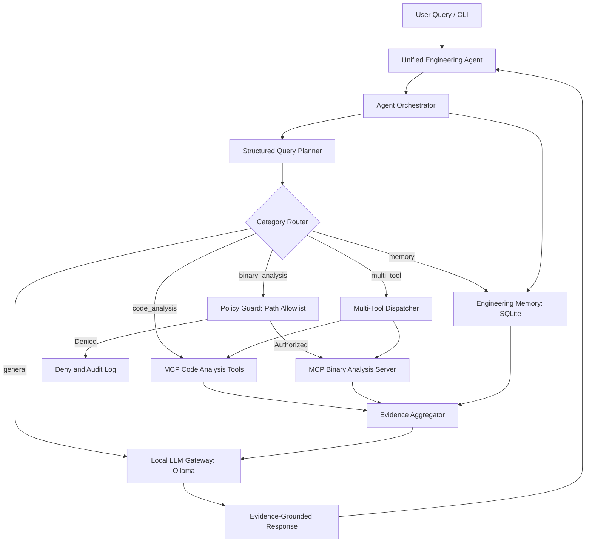

Samsung PRISM — Unified Local-LLM Engineering Agent
Local AI Agent for Code Comprehension, Static Binary Investigation, and Persistent Engineering Memory
1. Project Overview
The Unified Engineering Agent is an on-premise, local-LLM developer assistant developed for the Samsung PRISM program. It integrates a locally hosted Large Language Model (LLM) through Ollama with Model Context Protocol (MCP) tool servers, evidence aggregation, and persistent SQLite memory.

The agent is designed to support:
1. Code Comprehension: Query functions, callers, classes, module dependencies, and source-code relationships across local repositories.
2. Static Binary Investigation: Inspect authorized Windows PE/DLL binaries, including architecture, sections, imports/exports, printable strings, and machine-code disassembly without executing the binary.
3. Persistent Engineering Memory: Store and retrieve engineering findings across sessions, with verification tagging, secret redaction, and duplicate detection.
4. Evidence-Grounded Answers: Use empirical tool outputs to support responses with relevant source files, line numbers, and binary evidence when available.
5. Multi-Tool Orchestration: Coordinate code analysis, binary investigation, memory retrieval, and local LLM response generation.
2. Problem Statement
Software engineers often investigate unfamiliar codebases, complex dependencies, binary files, and engineering findings manually. This process can require significant time and repeated effort.

The Unified Engineering Agent addresses these challenges by combining a local language model with specialized analysis tools and persistent engineering memory.

The system aims to provide a unified workflow for code comprehension, static binary investigation, and knowledge reuse while keeping the primary LLM inference local.
3. Project Objectives
- Develop a local-LLM engineering assistant.
- Integrate source-code and binary-analysis tools through MCP.
- Implement structured query planning and orchestration.
- Generate responses grounded in analysis-tool evidence.
- Store and retrieve engineering findings across sessions.
- Implement security policies, authorization checks, and audit logging.
- Evaluate system functionality through automated tests and benchmarks.
- Support extensible engineering workflows through modular components.
4. System Architecture

Architecture Components
Component	Responsibility
Engineering Agent	Interactive CLI and user-query entry point
Planner	Determines query category and extracts relevant parameters
Orchestrator	Coordinates planning, tool execution, memory, and response generation
Local LLM Gateway	Connects to Ollama for local inference
MCP Client	Connects to configured MCP servers and discovers tools
Code Analysis Server	Provides source-code analysis capabilities
Binary Analysis Server	Provides static binary investigation capabilities
Evidence Aggregator	Normalizes and organizes tool results
Persistent Memory	Stores and retrieves engineering findings
Security Policy	Enforces configured authorization and validation rules
Audit Logging	Records relevant security and binary-analysis events

5. Technology Stack
Technology	Purpose
Python 3.11+	Core programming language
Ollama	Local LLM runtime
Qwen 2.5 1.5B	Default lightweight local language model
Model Context Protocol (MCP)	Standardized tool communication
Python AST	Source-code parsing and analysis
pefile	Windows PE binary inspection
Capstone Engine	Machine-code disassembly
SQLite3	Persistent engineering memory
Pydantic	Query-plan and data validation
asyncio	Asynchronous execution
unittest	Automated testing
Git and GitHub	Version control

6. Project Structure
Autonomous-Agentic-for-github-delivery-and-strategic-assessment/
├── config/
│   ├── settings.py
│   └── mcp_servers.json
├── agent/
│   ├── main.py
│   ├── orchestrator.py
│   ├── llm.py
│   ├── planner.py
│   ├── mcp_client.py
│   ├── evidence.py
│   └── policy.py
├── code_analysis/
│   └── code_server.py
├── binary_analysis/
│   ├── binary_server.py
│   └── rea_adapter.py
├── memory/
│   ├── memory.py
│   ├── session_manager.py
│   ├── binary_audit.log
│   └── engineering_memory.db
├── mcp_server/
│   └── test_server.py
├── benchmarks/
│   ├── datasets/
│   │   └── milestone1_ground_truth.json
│   ├── results/
│   ├── verification/
│   ├── benchmark_runner.py
│   └── evaluate_models.py
├── tests/
│   ├── test_benchmark_runner.py
│   ├── test_binary_analysis.py
│   ├── test_code_analysis.py
│   ├── test_mcp_client.py
│   ├── test_memory.py
│   ├── test_orchestrator.py
│   ├── test_planner.py
│   ├── test_policy.py
│   └── test_unified_memory.py
├── docs/
│   ├── architecture.md
│   ├── model_comparison.md
│   ├── security.md
│   └── milestone_1_completion_report.md
├── .env.example
├── requirements.txt
└── README.md
Note: Runtime-generated databases, logs, reports, and additional files may be present depending on execution and configuration.
7. Quick Start & Installation
7.1 Prerequisites
- Python 3.11 or a compatible version supported by the project
- Git
- Ollama
- Windows PowerShell for the documented Windows commands
- Visual Studio Code (recommended)
7.2 Clone the Repository
git clone https://github.com/VidhiSidana/Autonomous-Agentic-for-github-delivery-and-strategic-assessment.git
cd Autonomous-Agentic-for-github-delivery-and-strategic-assessment
7.3 Create and Activate a Virtual Environment
Create the environment:
python -m venv .venv
Activate it in Windows PowerShell:
.venv\Scripts\Activate.ps1
For Linux/macOS:
source .venv/bin/activate
7.4 Install Dependencies
python -m pip install -r requirements.txt
7.5 Configure Environment Variables
Copy the template file:
Copy-Item .env.example .env
Review the configuration in:
- config/settings.py
- config/mcp_servers.json
- .env.example
Configure local paths and settings according to the project setup.

For binary analysis, configure authorized binary directories using the environment variable supported by the project:
BINARY_ALLOWED_DIRS=/path/to/authorized/binaries
Use actual local directories in your environment. Do not commit secrets, credentials, or sensitive environment values to version control.
7.6 Install and Configure Ollama
Download Ollama from:

https://ollama.com/

Pull the default model:
ollama pull qwen2.5:1.5b
Verify that it is available:
ollama list
Test the model:
ollama run qwen2.5:1.5b "Explain what a Python function is in two sentences."
The project uses Ollama for local inference. Ensure Ollama is running before launching the agent.

If the LLM is unavailable, the application may use its configured fallback behavior to return empirical tool evidence where supported.
8. Running the Agent
From the project root, activate the virtual environment and run:
python agent/main.py
The agent starts its interactive CLI and accepts engineering queries.
8.1 Code Comprehension Examples
Who calls process_query?
Find functions in this codebase.
Which modules does agent/main.py depend on?
Find the definition of a function in the source code.
The available operations depend on the configured code-analysis tools and the repository being analyzed.
8.2 Binary Investigation Examples
Use only binaries you are authorized to inspect and paths permitted by the configured security policy.
Analyze binary /path/to/authorized/sample.exe and identify its architecture.
Disassemble binary /path/to/authorized/sample.exe.
Extract printable strings from binary /path/to/authorized/sample.exe.
Binary-analysis capabilities depend on the supported file format, installed dependencies, and configured MCP tools.
8.3 Persistent Engineering Memory Examples
Remember this finding: SQLite uses WAL mode for concurrent access. This is verified.
Search memory for SQLite findings.
Retrieve previous engineering findings.
Memory operations depend on the implemented planner and memory-tool interfaces.
8.4 Multi-Tool Query Example
Find the authentication function in the codebase and compare it with related binary functionality in an authorized application binary.
The orchestrator can route supported multi-tool queries to the relevant analysis tools and aggregate their results.
9. Automated Testing & Verification
The project uses Python's built-in unittest framework.
9.1 Run the Standard Test Suite
Ensure the virtual environment is active and dependencies are installed.
python -m unittest discover -s tests -v
9.2 Latest Standard Test Results
The latest complete standard test run reported:
Metric	Result
Total tests	60
Passed	58
Skipped	2
Failed	0
Errors	0
Runtime	Approximately 174 seconds

Result: All executed tests passed.

The two skipped tests were:
1. The optional full benchmark integration test.
2. A Windows symbolic-link test requiring additional permissions or Developer Mode.
9.3 Test Coverage
The test suite covers:
- Query planning and category routing.
- Code analysis and evidence.
- Binary analysis.
- MCP client behavior and argument validation.
- Memory CRUD and retrieval.
- Orchestrator workflows.
- Security policy and validation.
- Unified engineering memory.
- Benchmark persistence and subprocess error handling.
9.4 Run Individual Test Modules
MCP client tests:
python -m unittest tests.test_mcp_client -v
Memory tests:
python -m unittest tests.test_memory -v
Orchestrator tests:
python -m unittest tests.test_orchestrator -v
Benchmark runner tests:
python -m unittest tests.test_benchmark_runner -v
9.5 Run the Full Benchmark Integration Test Separately
The full benchmark integration test is opt-in to avoid lengthy benchmark execution during every standard test run.

In PowerShell:
$env:RUN_FULL_BENCHMARK="1"

python -m unittest tests.test_benchmark_runner.TestBenchmarkRunner.test_run_benchmarks_returns_summary -v
After execution:
Remove-Item Env:RUN_FULL_BENCHMARK
10. Benchmark & Model Evaluation
10.1 Ground-Truth Benchmark Suite
The project includes a deterministic 14-task ground-truth benchmark suite.

Run the benchmark:
python benchmarks/benchmark_runner.py
A previous full benchmark execution reported:
Metric	Result
Ground-truth tasks	14
Successful tasks	14
Reported success rate	100.0%

The benchmark covers areas including:
- PE architecture and metadata.
- Binary sections, imports, and exports.
- Capstone disassembly.
- Code architecture and comprehension.
- Cross-process memory persistence.
- Multi-tool execution.
- Dynamic schema validation.
The benchmark report is configured to be saved under:
benchmarks/results/benchmark_report.json
Raw verification output may be available under:
benchmarks/verification/
Note: The 14/14 result comes from a previous separate full benchmark execution. The full benchmark integration test was skipped in the latest standard test run.
10.2 Model Evaluation
The project includes a model evaluation framework for comparing local LLM performance.

Run:
python benchmarks/evaluate_models.py
Previously recorded results include:
Model	Tool-call accuracy	Valid JSON	Synthesis score
Qwen 2.5 1.5B	78.6%	100%	33.3%
Phi 3.5	64.3%	100%	66.7%
Llama 3.1 8B	78.6%	100%	66.7%
Mistral Nemo 12B	Not tested	Not tested	Not tested

These are previously recorded empirical results, not guarantees of performance on other hardware or prompts.

The evaluation framework considers:
- Tool-call accuracy.
- JSON output validity.
- Response latency.
- Evidence synthesis performance.
Detailed comparisons are documented in:
docs/model_comparison.md
The generated report is configured to be saved under:
benchmarks/results/model_evaluation_report.json
11. Milestone 1 Implementation Status
Milestone 1 established the foundational architecture and core engineering-agent capabilities.
Feature	Status	Notes
Local LLM Gateway	Implemented and tested	Ollama integration, availability checks, timeout handling, and fallback behavior
Structured Query Planner	Implemented and tested	Pydantic query plan, category detection, parameter extraction, and clarification handling
Multi-Server MCP Client	Implemented and tested	Tool discovery, schema handling, argument validation, and server connections
Dynamic MCP Orchestrator	Implemented and tested	Query routing, tool execution, and supported fallback behavior
Code Analysis MCP	Implemented and tested	AST-based source-code analysis
Binary Analysis MCP	Implemented and tested	Static PE inspection and Capstone-based disassembly
Policy and Path Security	Implemented and tested	Authorized path checks and security validation
Engineering Memory	Implemented	SQLite-based persistent storage
Benchmark Infrastructure	Implemented	Ground-truth benchmark runner

12. Milestone 2 Implementation Status
Milestone 2 extends the foundational agent with evidence aggregation, persistent engineering memory, orchestration improvements, security controls, and evaluation infrastructure.
12.1 Milestone 2 Feature Summary
Feature	Status	Description
Evidence Aggregation	Implemented and tested	Normalizes raw tool results into structured evidence
Evidence-Grounded Responses	Implemented	Uses empirical tool results to support responses
Orchestrator Integration	Implemented and tested	Coordinates planner, MCP tools, memory, and response generation
Multi-Tool Execution	Implemented and tested	Supports workflows involving multiple analysis tools
Persistent Engineering Memory	Implemented and tested	Stores and retrieves engineering findings using SQLite
Memory Verification Tags	Implemented	Supports statuses such as VERIFIED, HYPOTHESIS, and NEEDS_REVIEW
Memory Retrieval	Implemented and tested	Searches and retrieves previously stored findings
Cross-Process Persistence	Implemented and tested	Verifies that stored findings can be retrieved across separate processes
Session Management	Implemented and tested	Tracks engineering sessions and supports session-related memory organization
Security Policy Integration	Implemented and tested	Enforces configured authorization and validation checks
Secret Redaction	Implemented and tested	Redacts sensitive information in supported contexts
Audit Logging	Implemented and tested	Records relevant security and binary-analysis activities
Benchmark Infrastructure	Implemented and tested	Supports benchmark execution, reporting, and persistence checks
Model Evaluation	Implemented	Supports comparative evaluation of local language models
Standard Test Suite	Successfully executed	58 passed, 2 skipped, 0 failed, 0 errors

12.2 Persistent Engineering Memory
The memory subsystem uses SQLite to preserve engineering findings beyond individual interactions.

Capabilities include:
- Saving engineering findings.
- Searching and retrieving stored findings.
- Maintaining verification status.
- Organizing findings by session where supported.
- Retrieving findings across separate processes.
- Duplicate detection and secret redaction.
This enables the agent to reuse engineering knowledge instead of treating each investigation as an isolated task.
12.3 Evidence Aggregation and Orchestration
The evidence aggregation module organizes results returned by engineering tools.

The orchestrator coordinates the overall workflow:
1. Receives the engineering query.
2. Uses the planner to determine the query category.
3. Selects appropriate tools.
4. Executes MCP operations.
5. Aggregates available evidence.
6. Retrieves relevant engineering memory when required.
7. Produces an evidence-grounded response.
The architecture separates query planning, tool execution, evidence processing, and LLM response generation.
12.4 Security and Reliability
Milestone 2 builds on the project's security controls, including:
- Configured binary path authorization.
- Input and argument validation.
- Secret redaction.
- Audit logging.
- Controlled tool execution.
- Subprocess and benchmark error handling.
12.5 Known Issues and Limitations
MCP asynchronous session cleanup warning

Some MCP client cleanup scenarios log a warning similar to:
Attempted to exit cancel scope in a different task than it was entered in
The warning is caught and logged, and the latest standard test suite completed without failures.

However, this cleanup warning remains under investigation and should not be considered fully resolved.

Additional limitations include:
- Local LLM latency for complex queries.
- Dependence on correctly configured local MCP servers.
- External reverse-engineering dependencies where applicable.
- Need for further testing on larger repositories and binary datasets.
12.6 Milestone 2 Summary
Milestone 2 advances the project toward a more integrated engineering agent with persistent memory, evidence aggregation, orchestrated tool execution, and security-aware engineering workflows.

The latest standard test run completed with:

58 passed, 2 skipped, 0 failed, and 0 errors.

The project continues to undergo reliability improvements and documentation refinement before final demonstration and submission.
13. Security Considerations
The agent is intended for controlled engineering investigation.

Security considerations include:
- Restricting analysis to authorized source code and binaries.
- Enforcing configured binary path allowlists.
- Validating tool arguments and user inputs.
- Avoiding exposure of confidential information.
- Protecting environment variables and secrets.
- Maintaining relevant audit logs.
- Reviewing analysis results before taking consequential actions.
The agent should only be used with resources the user is authorized to investigate.

Further security details are available in:
docs/security.md
14. Known Limitations and Future Scope
Current Limitations
- Local LLM response latency can increase for complex requests.
- MCP asynchronous session cleanup warnings remain under investigation.
- Analysis results depend on the available tools, input files, and configuration.
- External reverse-engineering integration may require additional dependencies or credentials.
- Further benchmarking is needed across larger engineering projects.
Future Scope
1. Improve local LLM response speed.
2. Optimize MCP session lifecycle management.
3. Expand binary-analysis capabilities.
4. Improve evidence verification and confidence scoring.
5. Add larger benchmark datasets.
6. Enhance memory retrieval and ranking.
7. Improve the user interface.
8. Expand dependency and security analysis.
9. Support more complex engineering repositories.
10. Improve robustness of multi-tool workflows.
15. Conclusion
The Samsung PRISM Unified Engineering Agent demonstrates the integration of local language models, MCP-based engineering tools, evidence aggregation, and persistent memory into a unified engineering assistance system.

The project aims to simplify code comprehension, static binary investigation, and engineering knowledge management through a modular, extensible, and locally operated AI agent.

By combining specialized analysis tools with evidence-grounded responses and persistent engineering memory, the system provides a foundation for more efficient and intelligent engineering workflows.
16. Authors & Acknowledgements
Developed for Samsung PRISM:
- Vidhi Sidana — GitHub: @VidhiSidana
- Chintan Sood — GitHub: @chintansood