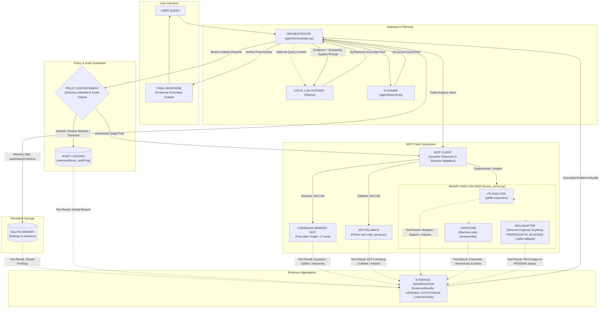
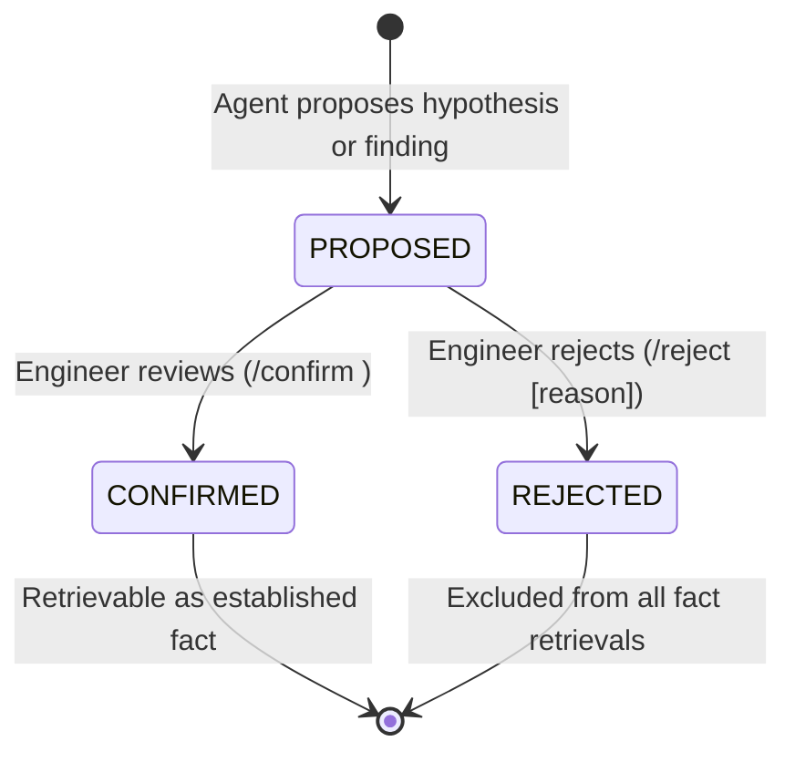

# Samsung PRISM — Unified Engineering Agent Architecture

## 1. System Overview
The **Unified Engineering Agent** is an on-premise AI-driven developer assistant designed for:
1. **Code Comprehension:** Querying software architecture, callers, callees, dependencies, and change impact using code graphs and AST analysis.
2. **Binary Investigation:** Reverse-engineering authorised compiled binaries statically without execution.
3. **Persistent Engineering Memory:** Multi-session SQLite store with verification tagging (`VERIFIED`, `HYPOTHESIS`, `NEEDS_REVIEW`).
4. **Local LLM Evidence Synthesis:** Answering questions through a local Ollama model (Qwen2.5 1.5B default) grounded strictly in empirical tool evidence.

---

## 2. End-to-End Tool-Call and Data-Flow Architecture



---

## 3. Core Component Responsibilities

| Component | Module | Responsibilities |
|---|---|---|
| **Local LLM Gateway** | `agent/llm.py` | Configurable Ollama API client (timeout, temperature, max tokens). Multi-turn chat support and local endpoint availability checks. |
| **Structured Planner** | `agent/planner.py` | Validates user queries into Pydantic `QueryPlan` (`CODE_ANALYSIS`, `BINARY_ANALYSIS`, `MEMORY`, `MULTI_TOOL`, `GENERAL`). Extracts function names, file paths, binary paths, memory search keywords, and flags missing parameters requiring user clarification. |
| **Agent Orchestrator** | `agent/orchestrator.py` | Coordinates planning, dynamic tool mapping via discovered schemas, memory queries, evidence aggregation, and LLM answer generation. |
| **MCP Client Manager** | `agent/mcp_client.py` | Connects to named MCP servers (`test`, `code_fallback`, `binary`, `code_graph`) via standard stdio, discovers available tools dynamically, validates arguments against schemas, and normalizes execution results. |
| **Codebase Memory MCP** | `tests/verify_codebase_memory_mcp.py` / `config/mcp_servers.json` | Live external MCP server powered by Tree-sitter. Provides 17 tools: repo indexing, symbol graph search, caller/callee path tracing, and architectural summaries. |
| **AST Code Analysis** | `code_analysis/code_server.py` | AST-based code analysis: function discovery, caller finding, callee analysis, class/method discovery, import relationships, and 2-hop change-impact traversal. Serves as reliable fallback. |
| **Binary Analysis MCP**| `binary_analysis/binary_server.py`| Static PE inspection: architecture detection, exported symbols, imported DLLs, printable strings, Capstone disassembly. Strictly enforced path allowlist and non-execution policy. |
| **REA Integration Adapter**| `binary_analysis/rea_adapter.py` | Adapter for open-source Reverse Engineer Anything (REA) MCP server (`morluto/rea`). Enforces policy authorization before invocation, verifies Node.js >= 22.23.4 and Ghidra/Java prerequisites, and cleanly triggers verified pefile/Capstone fallback when prerequisites are unmet. |
| **Policy & Audit** | `agent/policy.py` | Authorizes target binary paths against `BINARY_ALLOWED_DIRS` using filesystem-aware inode parent checks (`os.path.samefile`), prevents directory traversal and symlink escapes, redacts secrets, and writes sequential audit events to `memory/binary_audit.log`. |
| **Unified Memory** | `memory/memory.py` | SQLite persistent store (`findings` table) supporting full CRUD, primary key lookup (`get_memory_by_id`), duplicate detection, secret redaction, and verification statuses (`VERIFIED`, `HYPOTHESIS`, `NEEDS_REVIEW`, `REJECTED`). |
| **Session Manager** | `memory/session_manager.py` | Tracks work session IDs (`session_<hex>`), start/end timestamps, query counts, and compact session summaries. |
| **Evidence Aggregator**| `agent/evidence.py` | Normalizes tool outputs into `EvidenceItem` and `EvidenceBundle` objects. Categorizes findings into VERIFIED, HYPOTHESIS, and LIMITATIONS to prevent LLM hallucinations. |

---

## 4. Query Execution Flow

1. **User Request:** User submits a prompt via CLI or automated test.
2. **Planning:** `AgentPlanner` assigns a `QueryCategory` and extracts parameters.
   - If an essential parameter (e.g. binary path) is missing, a clarification request is returned immediately.
3. **Tool Invocation:**
   - Code queries invoke `code_graph` dynamically matching tools via discovered schemas (or falls back to `code_fallback`).
   - Binary queries validate path authorization with `agent.policy` and invoke `binary_server` (PE / Capstone / REA).
   - Memory queries search or retrieve from `EngineeringMemory`.
4. **Evidence Aggregation:** Tool results are normalized into an `EvidenceBundle` preserving raw tool outputs, line numbers, and symbols.
5. **Local LLM Synthesis:**
   - `build_llm_prompt` constructs a system prompt forbidding hallucination.
   - Ollama generates an evidence-backed explanation citing exact file paths, line numbers, and symbols.
   - If Ollama is offline or model is not pulled, a clean fallback displaying the empirical evidence is returned.
6. **Session & Memory Update:** The query is counted in the active session; confirmed hypotheses can be promoted to verified memory.

---

## 5. Declarative MCP Configuration

MCP servers are defined declaratively in `config/mcp_servers.json`:

```json
{
  "servers": {
    "test": {
      "command": "${PYTHON}",
      "args": ["mcp_server/test_server.py"]
    },
    "code_fallback": {
      "command": "${PYTHON}",
      "args": ["code_analysis/code_server.py"]
    },
    "binary": {
      "command": "${PYTHON}",
      "args": ["binary_analysis/binary_server.py"]
    },
    "code_graph": {
      "command": "codebase-memory-mcp",
      "args": [],
      "enabled": false
    }
  }
}
```

---

## 6. Milestone 2 Unified Memory & Curated Layer

Milestone 2 establishes a dual-tier unified memory system combining structured SQLite storage with human-reviewable Markdown files:

1. **Automatic Session Capture Hooks (`memory/session_manager.py`):**
   - `on_query(session_id, query, intent)`: Automatically logs user intent and queries with secret redaction into the `session_events` audit table.
   - `on_tool_result(session_id, tool_name, args, success, evidence_refs, token_count)`: Captures tool parameters, execution status, evidence provenance, and token usage per step.
   - `on_session_end(session_id, summary, llm)`: Synthesizes a technical session summary using the local Ollama LLM. When offline, automatically activates a deterministic extractive summarizer labelled `extractive (LLM unavailable)`. Records summarization latency and token usage.
   - `get_resume_digest(session_id, max_tokens=500)`: Compiles previous session summaries and confirmed findings within strict context token limits.

2. **Curated Markdown Memory (`memory/curated/` & `memory/curated_memory.py`):**
   - Stored as human-readable `.md` files with lossless YAML frontmatter:
     ```yaml
     ---
     id: 12
     title: "Function discovery in main"
     category: "engineering_finding"
     status: "CONFIRMED"
     evidence_refs: "ast_search:agent/main.py:98"
     date: "2026-11-10T12:00:00Z"
     confirmed_by: "engineer"
     ---
     ```
   - **Two-Way Lossless Sync:** `export_curated_memory()` dumps SQLite findings to Markdown; `import_curated_memory()` scans for direct engineer edits on disk and re-synchronizes changes back into SQLite.
   - **Dual-Layer Deduplication:** Matches normalized SHA-256 text hashes and word-level Jaccard similarity (threshold $\ge 0.8$) across both SQLite and Markdown layers.
   - **Stale Detection:** Detects whether files or symbols referenced in `evidence_refs` or content have been renamed or deleted on disk, automatically marking invalid records with `is_stale = 1`.
   - **Secret Redaction:** `redact_secrets()` is enforced across all write paths (SQLite inserts/updates, session events, and Markdown files).

---

## 7. Engineer Confirmation Flow

To prevent unverified hypotheses or model speculations from polluting factual memory, Milestone 2 enforces an explicit confirmation lifecycle:



- **Quarantine:** Findings with `PROPOSED` status are quarantined and **never** returned in default `retrieve_memory()` or `search_memory()` queries.
- **Provenance Tracking:** Every record captures `evidence_refs` (`tool:file:line`), `session_id`, `created_at`, `confirmed_by`, `confirmed_at`, and optional `rejection_reason`.
- **CLI Commands:**
  - `/pending`: Inspect findings awaiting confirmation.
  - `/confirm <id>`: Promote a proposed finding to `CONFIRMED`.
  - `/reject <id> [reason]`: Reject a finding with rationale.

---

## 8. Dynamic Tool Router & Context Budget Manager

To prevent small local models (Qwen 1.5B, Phi-3.5) from suffering context window overflow or tool hallucination, Milestone 2 introduces dynamic context and schema control:

1. **Dynamic Tool Router (`agent/tool_router.py`):**
   - Filters tools by query category to expose only 4–8 relevant tools instead of the monolithic tool catalog.
   - Compresses REA reverse engineering tools to a compact, high-value subset: `binary_overview`, `analyze_function`, `batch_decompile`, `build_call_path`, plus local PE/Capstone tools.
   - Reduces tool selection prompt overhead from ~842 tokens to **~301 tokens (-64.2% reduction)**.

2. **Context Budget Manager (`agent/context_budget.py`):**
   - Configurable per-model context limits (`qwen2.5:1.5b`: 4096 tokens, `phi3.5:latest`: 8192 tokens, `llama3.1:8b`: 16384 tokens).
   - **Priority Compaction:**
     1. System instructions (never dropped)
     2. Verified evidence (locations, line numbers, and symbols preserved; tool text truncated to budget)
     3. Memory findings (titles/summaries retained; full dumps dropped)
     4. Session history (compacted to recent turns)
     5. Category-routed compact schemas
   - Logs all truncated or dropped components in `dropped_log`.
   - **Synthesis Guardrails:** Instructs model to refuse missing facts (`INSUFFICIENT EVIDENCE`) and reject contradictory false premises.

---

## 9. Zero-Egress Network Architecture

All operations are strictly on-premise:
- **Local Endpoints Only:** Outbound connections are confined to `127.0.0.1:11434` (Ollama) and local UNIX pipes (stdio MCP servers).
- **Socket Interception:** `ZeroEgressMonitor` intercepts socket initialization during evaluation and enforces immediate refusal on any non-local connection.
- **Audit Verification:** Verified 100% compliant in `benchmarks/results/e2e_report.json`.
