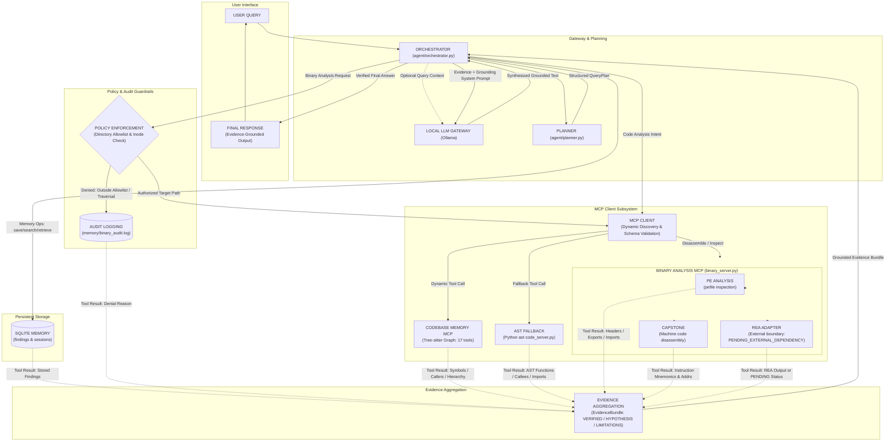

# Samsung PRISM — Unified Engineering Agent Architecture

## 1. System Overview
The **Unified Engineering Agent** is an on-premise AI-driven developer assistant designed for:
1. **Code Comprehension:** Querying software architecture, callers, callees, dependencies, and change impact using code graphs and AST analysis.
2. **Binary Investigation:** Reverse-engineering authorised compiled binaries statically without execution.
3. **Persistent Engineering Memory:** Multi-session SQLite store with verification tagging (`VERIFIED`, `HYPOTHESIS`, `NEEDS_REVIEW`).
4. **Local LLM Evidence Synthesis:** Answering questions through a local Ollama model (Qwen2.5 1.5B default) grounded strictly in empirical tool evidence.

---

## 2. End-to-End Tool-Call and Data-Flow Architecture



---

## 3. Core Component Responsibilities

| Component | Module | Responsibilities |
|---|---|---|
| **Local LLM Gateway** | `agent/llm.py` | Configurable Ollama API client (timeout, temperature, max tokens). Multi-turn chat support and local endpoint availability checks. |
| **Structured Planner** | `agent/planner.py` | Validates user queries into Pydantic `QueryPlan` (`CODE_ANALYSIS`, `BINARY_ANALYSIS`, `MEMORY`, `MULTI_TOOL`, `GENERAL`). Extracts function names, file paths, binary paths, memory search keywords, and flags missing parameters requiring user clarification. |
| **Agent Orchestrator** | `agent/orchestrator.py` | Coordinates planning, dynamic tool mapping via discovered schemas, memory queries, evidence aggregation, and LLM answer generation. |
| **MCP Client Manager** | `agent/mcp_client.py` | Connects to named MCP servers (`test`, `code_fallback`, `binary`, `code_graph`) via standard stdio, discovers available tools dynamically, validates arguments against schemas, and normalizes execution results. |
| **Codebase Memory MCP** | `tests/verify_codebase_memory_mcp.py` / `config/mcp_servers.json` | Live external MCP server powered by Tree-sitter. Provides 17 tools: repo indexing, symbol graph search, caller/callee path tracing, and architectural summaries. |
| **AST Code Analysis** | `code_analysis/code_server.py` | AST-based code analysis: function discovery, caller finding, callee analysis, class/method discovery, import relationships, and 2-hop change-impact traversal. Serves as reliable fallback. |
| **Binary Analysis MCP**| `binary_analysis/binary_server.py`| Static PE inspection: architecture detection, exported symbols, imported DLLs, printable strings, Capstone disassembly. Strictly enforced path allowlist and non-execution policy. |
| **REA Integration Adapter**| `binary_analysis/rea_adapter.py` | Adapter for Samsung Reverse Engineering Assistant (REA). Strictly checks environment; safely reports `PENDING_EXTERNAL_DEPENDENCY` when external binaries/specs are pending, preserving PE/Capstone fallback. |
| **Policy & Audit** | `agent/policy.py` | Authorizes target binary paths against `BINARY_ALLOWED_DIRS` using filesystem-aware inode parent checks (`os.path.samefile`), prevents directory traversal and symlink escapes, redacts secrets, and appends immutable audit events to `memory/binary_audit.log`. |
| **Unified Memory** | `memory/memory.py` | SQLite persistent store (`findings` table) supporting full CRUD, primary key lookup (`get_memory_by_id`), duplicate detection, secret redaction, and verification statuses (`VERIFIED`, `HYPOTHESIS`, `NEEDS_REVIEW`, `REJECTED`). |
| **Session Manager** | `memory/session_manager.py` | Tracks work session IDs (`session_<hex>`), start/end timestamps, query counts, and compact session summaries. |
| **Evidence Aggregator**| `agent/evidence.py` | Normalizes tool outputs into `EvidenceItem` and `EvidenceBundle` objects. Categorizes findings into VERIFIED, HYPOTHESIS, and LIMITATIONS to prevent LLM hallucinations. |

---

## 4. Query Execution Flow

1. **User Request:** User submits a prompt via CLI or automated test.
2. **Planning:** `AgentPlanner` assigns a `QueryCategory` and extracts parameters.
   - If an essential parameter (e.g. binary path) is missing, a clarification request is returned immediately.
3. **Tool Invocation:**
   - Code queries invoke `code_graph` dynamically matching tools via discovered schemas (or falls back to `code_fallback`).
   - Binary queries validate path authorization with `agent.policy` and invoke `binary_server` (PE / Capstone / REA).
   - Memory queries search or retrieve from `EngineeringMemory`.
4. **Evidence Aggregation:** Tool results are normalized into an `EvidenceBundle` preserving raw tool outputs, line numbers, and symbols.
5. **Local LLM Synthesis:**
   - `build_llm_prompt` constructs a system prompt forbidding hallucination.
   - Ollama generates an evidence-backed explanation citing exact file paths, line numbers, and symbols.
   - If Ollama is offline or model is not pulled, a clean fallback displaying the empirical evidence is returned.
6. **Session & Memory Update:** The query is counted in the active session; confirmed hypotheses can be promoted to verified memory.

---

## 5. Declarative MCP Configuration

MCP servers are defined declaratively in `config/mcp_servers.json`:

```json
{
  "servers": {
    "test": {
      "command": "${PYTHON}",
      "args": ["mcp_server/test_server.py"]
    },
    "code_fallback": {
      "command": "${PYTHON}",
      "args": ["code_analysis/code_server.py"]
    },
    "binary": {
      "command": "${PYTHON}",
      "args": ["binary_analysis/binary_server.py"]
    },
    "code_graph": {
      "command": "codebase-memory-mcp",
      "args": [],
      "enabled": false
    }
  }
}
```
