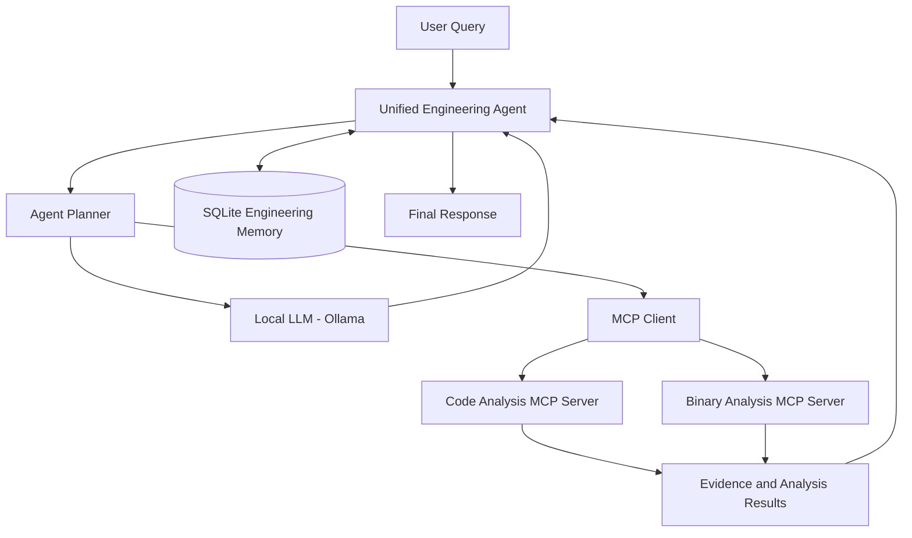

# Unified Engineering Agent Architecture

## 1. Project Overview

The Unified Engineering Agent is a local AI-powered system designed to assist engineers with code comprehension, binary investigation, and persistent engineering memory.

The system uses a local Large Language Model (LLM), an agent planner, MCP tools, and persistent memory.

## 2. Architecture Diagram

## 3. Main Components

### Local LLM
- Runs locally using Ollama.
- Uses the Qwen2.5 1.5B model.
- Generates responses to engineering questions.

### Agent Planner
- Classifies user queries.
- Identifies whether the request involves code analysis, binary analysis, memory, or general questions.
- Routes requests to the appropriate component.

### MCP Client
- Connects the unified agent to MCP servers.
- Discovers available tools.
- Executes tool requests and retrieves results.

### Code Analysis MCP Server
- Identifies functions and source-code locations.
- Finds function callers.
- Analyzes module relationships.

### Binary Analysis MCP Server
- Identifies functions in binary files.
- Supports function inspection.
- Retrieves disassembly or decompiled evidence when available.

### Persistent Engineering Memory
- Uses SQLite for persistent storage.
- Saves engineering findings.
- Retrieves and searches previous findings.

## 4. Data Flow

1. The user submits a query.
2. The unified engineering agent receives the query.
3. The planner identifies the query category.
4. The agent selects the appropriate LLM or MCP tool.
5. MCP tools execute code or binary analysis when required.
6. The agent collects analysis results and supporting evidence.
7. Engineering findings can be stored in persistent memory.
8. The agent generates a response for the user.

## 5. Technology Stack

- Python
- Ollama
- Qwen2.5 1.5B
- Model Context Protocol (MCP)
- SQLite
- Git and GitHub
