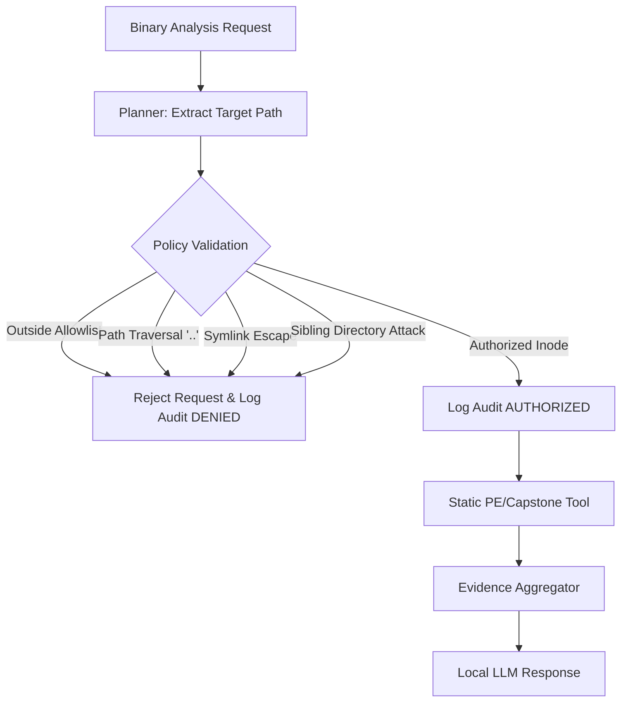

# Samsung PRISM: Privacy, Safety & Security Specification

## 1. Local-First Architecture & Network Boundaries
The **Samsung PRISM Unified Engineering Agent** is architected for on-premise local development:
* **LLM Calls:** Directed exclusively to the local Ollama daemon running at `http://localhost:11434` over the local loopback interface. The agent does not initiate outbound cloud API requests to external LLM providers during query processing or benchmark evaluation.
* **Internal MCP Servers:** Core tool servers (`code_analysis/code_server.py`, `binary_analysis/binary_server.py`, `mcp_server/test_server.py`) run as child processes communicating over local POSIX `stdio` pipes.
* **Persistent Memory:** Stored in a local SQLite database file (`memory/engineering_memory.db`). No telemetry or telemetry pings are sent.
* **Network Boundary Clarification:** While the agent application makes no outbound HTTP/HTTPS requests beyond the local Ollama loopback, complete host-level network isolation or air-gapping must be enforced by the host operating system sandbox or firewall policies.

---

## 2. Binary Analysis Safety Guardrails

### 2.1 Non-Execution Guarantee
* **The agent does not execute target binaries under analysis.**
* Analysis is strictly static, read-only, and bounded:
  * Static PE file parsing via `pefile`
  * Static machine code instruction disassembly via `capstone`
  * Static string extraction via regular expressions
* No process is spawned from the target binary, attached via debugger, or injected into memory.

### 2.2 Directory Allowlisting (`BINARY_ALLOWED_DIRS`)
* All binary analysis requests pass through `agent.policy.authorize_binary_path()`.
* Target binaries must reside within directories explicitly enumerated in `BINARY_ALLOWED_DIRS` in `.env`.
* If `BINARY_ALLOWED_DIRS` is empty or unconfigured, all binary analysis requests are **DENIED BY DEFAULT**.

### 2.3 Filesystem-Aware Path Containment & Escape Defenses
* **Path Traversal Rejection:** Any raw path string or path component containing `..` is rejected immediately prior to resolution.
* **Symlink Escape Defense:** Target paths are resolved to their canonical physical target on disk via `Path.resolve()`. If a symlink within an approved directory points to a location outside approved boundaries (e.g. `/etc/shadow`), it is rejected.
* **Filesystem-Aware Containment:**
  - Evaluates standard canonical hierarchy containment via `resolved.relative_to(allowed)`.
  - Performs filesystem-level inode parent verification (`os.path.samefile`) on parent directories.
  - Avoids naive lowercase-prefix string checks that could leak access on case-sensitive filesystems.
  - Sibling directory attacks (e.g. `/path/allowed_sibling` matching a prefix of `/path/allowed`) are strictly rejected.

### 2.4 Append-Only Audit Logging (`BINARY_AUDIT_LOG`)
* Every binary analysis inspection attempt records an append-only audit entry in CSV format to `memory/binary_audit.log`.
* Note: The log file is maintained via standard sequential file append (`open(..., 'a')`). It provides an audit trail of requested operations and outcomes, but is not cryptographically signed or tamper-proof at the OS kernel level.
* Audit record fields:
  * `timestamp_utc`: ISO 8601 UTC timestamp
  * `session_id`: Unique identifier for the active work session
  * `operation`: Specific tool invoked (`analyze_binary`, `disassemble_binary`, etc.)
  * `target_path`: Resolved absolute file path
  * `authorized`: `yes` or `no`
  * `result_status`: `SUCCESS`, `DENIED`, `FILE_NOT_FOUND`, `INVALID_PE`
  * `extra`: Operation metadata (with secrets automatically redacted)

---

## 3. Secret & Credential Redaction
* All user inputs, tool responses, and memory records pass through `agent.policy.redact_secrets()`.
* Sensitive patterns (`password`, `api_key`, `token`, `secret_key`, `private_key`) are masked with `[REDACTED]` before persistence into SQLite or writing to logs.

---

## 4. External MCP Server Dependencies

The agent can connect to external servers such as `codebase-memory-mcp`:
* **Process Boundary:** External MCP servers run as dedicated OS processes over `stdio`.
* **Execution Environment:** In sandbox environments, the external server executable (e.g., `/Users/<user>/.local/bin/codebase-memory-mcp`) must be present in the execution path or granted OS permissions.
* **Resilient Fallback:** If the external MCP server is unavailable, disabled, or fails to connect, the agent emits an explicit limitation warning and falls back to its local AST-based analysis server (`code_fallback`), preserving end-to-end functionality.

---

## 5. Samsung REA Dependency Status

* **Status:** `PENDING_EXTERNAL_DEPENDENCY`.
* **Safety Principle:** The agent does not invent hypothetical command-line flags, HTTP endpoints, or simulated responses for the Samsung Reverse Engineering Assistant (REA).
* **Isolation:** The `REAAdapter` evaluates official executable availability. While external Samsung PRISM binaries or specifications are awaited, the adapter reports `PENDING_EXTERNAL_DEPENDENCY` and delegates all disassembly and binary analysis to the verified `pefile` and `Capstone` local engine.

---

## 6. Known Security & Execution Limitations

1. **Format Scope:** Static binary analysis is currently validated on Microsoft Windows PE/DLL architectures (x86/x64). Linux ELF and macOS Mach-O inspection require additional loader modules slated for Milestone 2.
2. **Decompilation:** High-level C/C++ pseudo-decompilation relies on external decompiler integrations (e.g., Ghidra or REA). The current Milestone 1 baseline delivers machine-code assembly via Capstone.
3. **Environment Allowlisting:** Modifying `BINARY_ALLOWED_DIRS` requires administrative configuration in `.env` and cannot be modified at runtime by unprivileged agent queries.

---

## 7. Verification & Policy Enforcement Flow

